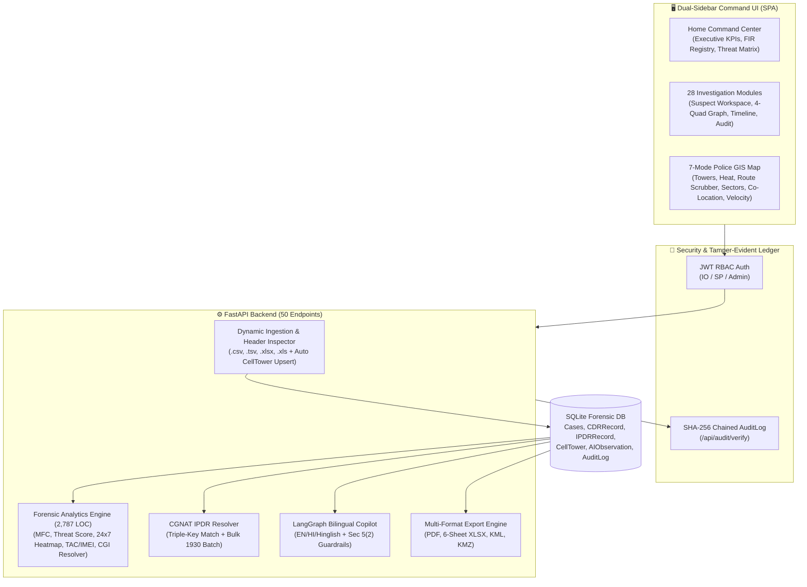

# 🚔 Rajasthan Police Cyber Forensic Command Center (`CDR/IPDR Intelligence & AI Copilot`)

[](https://python.org)
[](https://fastapi.tiangolo.com)
[](https://langchain-ai.github.io/langgraph/)
[](tests/)
[-crimson)](docs/security_audit_chain.md)

**A full-stack, zero-dummy, dynamic telecommunications forensics platform built for the Rajasthan Police Cyber Crime Wing (PS03).**  
Engineered for Law Enforcement Agencies (LEAs), Cyber Police Stations, and Special Task Forces to ingest heterogeneous telecom CSV/TSV/Excel dumps, correlate syndicate networks across **28 interactive analytical modules**, trace physical tower movements across **7 tactical GIS map modes**, de-anonymize **Carrier-Grade NAT (CGNAT) IPDR** logs, and generate **Section 65B(4) / BSA Section 63 court-admissible** dossiers & Google Earth KML/KMZ packages.

---

## 🏗️ System Architecture & Dynamic Forensic Pipeline

Every metric, table, graph, and map coordinate in this platform is computed **100% dynamically** from uploaded case evidence—with zero hardcoded demo payloads in the analytics pipeline.



---

## ✨ What’s New in the Overhauled Forensic Edition

- **Zero-Dummy Dynamic Architecture:** Removed static demo routes (`POST /api/cases/demo` retired). All dashboards, suspect summaries, network distributions, and GIS markers populate strictly from real uploaded CSV/TSV/Excel evidence batches.
- **Dual-Sidebar Forensic Command UI:** Seamlessly switch between **Home Command Center** (executive oversight, FIR registration with `case_type`, `police_station`, `investigator_name`, `status`) and **28 Investigation Modules** with crisp monochrome vector iconography.
- **Suspect Investigation Workspace (10 KPIs + Real Ownership):** Instant per-suspect summary (`GET /api/cases/{case_id}/suspect/{phone}/summary`), real entity resolution against `service_directory.json` + case brief metadata, and telecom operator distribution bars (Jio, Airtel, Vi, BSNL, International, Service).
- **4-Quadrant Graph Analytics (`graph`):** Simultaneously inspects Interactive Cytoscape Syndicate Topology, Degree & Centrality Rankings, High-Volume Mutual Call Pairs, and Cross-Suspect Shared Bridges.
- **7-Mode Police GIS Map & Chronological Playback:**
  1. **Cell Towers Pin** (CGI-aware resolution with tower metadata)
  2. **Signal Density Heatmap**
  3. **Route Trajectory + Time Scrubber** (animated chronological suspect movement replay)
  4. **Day vs. Night Tower Clusters**
  5. **65° Tri-Sector Azimuth Antenna Cones** (`GET /api/cases/{case_id}/towers/sectors`)
  6. **Spatial-Temporal Co-Location Meetings** (`GET /api/cases/{case_id}/meetings`)
  7. **Impossible Travel Velocity Alerts** (`GET /api/cases/{case_id}/velocity-anomalies`, flags >120 km/h non-flight hops)
- **Smart Auto-Upserting Tower Ingestion:** Automatically extracts tower coordinates from `First CGI Lat/Long`, `Last CGI Lat/Long`, `Lat`/`Lon`, and `Tower Address` columns during CDR import—even when towers aren’t pre-seeded in master CSVs.
- **KML / KMZ Google Earth & Statutory Exports:** Generates court-ready 8-section PDFs (with Section 65B(4) / Section 63 BSA 2023 SHA-256 certificate), 6-sheet Excel workbooks, and Google Earth `.kml`/`.kmz` packages (`?format=pdf|xlsx|kml|kmz&suspect=...`).

---

## 🛠️ Technology Stack

| Layer | Technologies |
| :--- | :--- |
| **Backend & API** | Python 3.11+, FastAPI, Uvicorn, Pydantic v2, SQLAlchemy ORM |
| **Database** | SQLite (`cyber_forensics.db`) with normalized indices & SHA-256 chained audit logs |
| **Analytics & Data** | Pandas, NumPy, OpenPyXL (Excel `.xlsx`/`.xls` ingestion & reporting), `reportlab` (PDF), `zipfile` (KMZ) |
| **AI & Agents** | LangGraph (`StateGraph` workflow), Bilingual EN/HI/Hinglish Intent Router, Section 5(2) Guardrails |
| **Frontend UI** | Vanilla ES6+ SPA (`app/static/`), Leaflet.js (7 GIS modes), Cytoscape.js (Network Graphs), Chart.js |
| **Security & Auth** | JWT Bearer Tokens (`python-jose`), `bcrypt` password hashing, Multi-Tier RBAC, SHA-256 Ledger |

---

## 🚀 Quick Start & Local Deployment

### 1. Environment Setup
```bash
git clone <repository-url>
cd Rajistanhackathon

python3 -m venv .venv
source .venv/bin/activate
pip install -r requirements.txt
```

### 2. Run the Command Center Server
```bash
.venv/bin/uvicorn app.main:app --host 0.0.0.0 --port 8000 --reload
```
On startup (`app/main.py::on_startup`), the database schema is initialized (`init_db()`), default police officer credentials are seeded (`seed_default_users()`), and cell towers are loaded (`seed_towers_from_csv()`).

- **Live Forensic Workspace:** [http://127.0.0.1:8000](http://127.0.0.1:8000)
- **Interactive CodeWiki Docs:** Open [`docs/index.html`](docs/index.html) via local HTTP server (e.g. `python3 -m http.server 8080 -d docs`)
- **OpenAPI / Swagger UI:** [http://127.0.0.1:8000/docs](http://127.0.0.1:8000/docs)

---

## 🔐 Role-Based Access Control (RBAC) Credentials

Verified officer accounts seeded on startup by [`app/auth.py`](app/auth.py):

| Role Identifier | Display Name | Username | Password | Badge ID | Access Scope |
| :--- | :--- | :--- | :--- | :--- | :--- |
| **`investigating_officer`** | Inspector Ajay Sharma | `io_sharma` | `IO@RajPolice2026` | `RAJ-POL-IO-42` | FIR case creation, CSV/XLSX ingestion, 28 analytics modules, CGNAT IPDR batch triage, AI Copilot queries, Report export |
| **`senior_officer`** | SP Sangeeta Verma | `sp_verma` | `SP@RajPolice2026` | `RAJ-POL-SP-09` | Full investigative rights + exclusive authority to `verify`/`reject` AI observations for judicial admissibility |
| **`admin`** | ACP Ramesh Meena | `admin` | `Admin@RajPolice2026` | `RAJ-POL-ADM-01` | Read-only investigative inspection + mapping management + cryptographic SHA-256 audit log verification (`/api/audit/verify`) |

---

## 📂 Police-Ready Comprehensive Sample Datasets

Two complete sample suites exist for immediate testing—[`sample_data/`](sample_data/) and [`data/sample_police_data/`](data/sample_police_data/)—generated by [`scripts/generate_police_samples.py`](scripts/generate_police_samples.py), alongside raw multi-operator fixtures in `data/`:

| File | Records | Columns / Schema Highlights |
| :--- | :--- | :--- |
| `sample_data/sample_cdr_comprehensive.csv` | **1,500 rows** | Full 23-column LEA schema (`Target No`, `Calling Party Telephone Number`, `Called Party Telephone Number`, `Call Type`, `Call Date Time`, `Dur(s)`, `First Cell ID`, `First CGI`, `First CGI Lat/Long`, `Last Cell ID`, `Last CGI`, `Last CGI Lat/Long`, `Tower Address`, `IMEI`, `IMSI`, `Service Provider`, `Disconnect Cause`) |
| `sample_data/sample_ipdr_comprehensive.csv` | **1,000 rows** | Full 24-column DoT/CGNAT schema (`Subscriber MSISDN`, `Source IP`, `Source Port`, `Translated IP`, `Translated Port`, `Destination IP`, `Destination Port`, `Protocol`, `Session Start Time`, `Session End Time`, `Data Volume Up Link`, `Data Volume Down Link`, `App Protocol Hint`, `Application`, `PGW IP Address`, `IMEI`, `IMSI`) |
| `sample_data/sample_cell_towers.csv` | **14 towers** | Geo-located Rajasthan BTS towers across Jaipur, Ajmer, Kota, Jodhpur, Alwar, and Bharatpur (`cell_id`, `lac`, `lat`, `lon`, `area_name`, `azimuth`, `operator`) |

Regenerate fresh sample files at any time:
```bash
.venv/bin/python scripts/generate_police_samples.py
```

---

## 🧪 End-to-End Investigation Walkthrough

1. **Authenticate:** Sign in at `http://127.0.0.1:8000` using `io_sharma` / `IO@RajPolice2026`.
2. **Register an FIR Case:** Click **+ New FIR / Case** in the Home Command Center (`POST /api/cases`), supplying FIR ID, title, `case_type`, `police_station`, and `investigator_name`.
3. **Dynamic Header Inspection & Upload:** Open **Import CSV / Excel**, upload `sample_data/sample_cdr_comprehensive.csv` (the UI calls `POST /api/ingest/inspect` to auto-detect headers, delimiters, and LEA preambles, or apply any preset from `data/mappings/*.json` / custom JSON mapping via `POST /api/cases/{case_id}/upload`). Then upload `sample_data/sample_ipdr_comprehensive.csv` as `file_type=IPDR`.
4. **Correlate Across 28 Modules:** Toggle the sidebar to **Investigation Modules** to inspect Executive Metrics, Suspect Workspace (10 KPIs), 4-Quad Syndicate Graph, Threat Risk Scores, 24×7 Temporal Heatmap, IMEI/SIM Swaps, TAC Handsets, and Service/International contacts.
5. **Trace Physical Mobility & Co-Location:** Open **Geo Map** and cycle through all **7 Map Modes** (including the chronological Route Scrubber, 65° Sector Cones, Co-Location Meetings, and >120 km/h Velocity Anomalies).
6. **De-Anonymize Cyber Leads:** In **IPDR CGNAT**, click **Load Real Session Sample** (`GET /api/cases/{case_id}/ipdr/sample`) or submit bulk complainant tuples to `POST /api/cases/{case_id}/ipdr/batch`.
7. **Bilingual AI & SP Verification:** Query the LangGraph AI Copilot in English or Hinglish (`POST /api/cases/{case_id}/assistant`), then log in as `sp_verma` (`SP@RajPolice2026`) to certify observations (`POST /api/cases/{case_id}/observations/{obs_id}/verify`).
8. **Export & Verify Chain of Custody:** Download **PDF**, **6-Sheet Excel**, **KML**, or **KMZ** reports (`GET /api/cases/{case_id}/report?format=...`) and verify the SHA-256 ledger (`GET /api/audit/verify`).

---

## ✅ Automated Verification Suite (`47 / 47 Passed`)

Run the complete test suite:
```bash
PYTHONPATH=. .venv/bin/pytest
```

| Test File | Tests Covered | Key Verification Scope |
| :--- | :--- | :--- |
| [`tests/test_core.py`](tests/test_core.py) | **7 tests** | SQLite schema, phone/duration normalization, CDR validation & rejection tracking, Excel `.xlsx` ingestion, IPDR inspection, common numbers, IMEI/SIM swap detection, Section 5(2) AI guardrails |
| [`tests/test_demo_flow.py`](tests/test_demo_flow.py) | **1 test** | End-to-end API flow: login, FIR creation, CSV ingestion, patterns, common numbers, meetings, device changes, IPDR match, AI query, SP verification, PDF export, audit trail |
| [`tests/test_external_datasets.py`](tests/test_external_datasets.py) | **2 tests** | Real multi-operator external LEA dataset compatibility (`sandhan_operator`, `vega_operator`) |
| [`tests/test_forensic_suite.py`](tests/test_forensic_suite.py) | **37 tests** | All 28 analytical views, TAC cache, RBAC 401/403 enforcement, LEA preamble stripping, threat scoring, 24×7 heatmap, batch IPDR CGNAT, SHA-256 hash chain tamper detection, PDF/XLSX/KML/KMZ exports, frontend workspace asset verification |

---

## 📚 Comprehensive Repository & Module Documentation

Detailed technical guides, Mermaid workflows, schemas, and mathematical formulas are maintained in [`docs/`](docs/):

| Guide | Focus Area |
| :--- | :--- |
| 📖 **[System Architecture Overview](docs/overview.md)** | End-to-end architecture, 28 UI modules, database ORM models, and data flow |
| 📥 **[Ingestion & Normalization Engine](docs/ingestion_engine.md)** | CSV/TSV/Excel parser, LEA preamble stripping, 9 operator presets, header inspector, auto tower upserts |
| 🧠 **[Forensic Analytics Engine](docs/forensic_analytics.md)** | Suspect workspace, threat risk scoring (`0–100`), 24×7 heatmap, MFC, SIM/IMEI swaps, TAC lookup, link analysis |
| 🗺️ **[Geospatial Tracking & 7 GIS Maps](docs/geospatial_tracking.md)** | CGI tower matching, 65° tri-sector azimuth cones, co-location meetings, velocity anomalies (`>120 km/h`) |
| 🕸️ **[Network Topology & 4-Quad Graph](docs/network_topology.md)** | Cytoscape graph payload, node/edge metrics, mutual pairs, shared syndicate bridge isolation |
| 🌐 **[IPDR & CGNAT Resolver](docs/ipdr_nat_resolver.md)** | Triple-key IP/port/timestamp matching, `tolerance_minutes` windowing, bulk 1930 batch lookup |
| 🤖 **[AI Investigation Assistant](docs/ai_assistant.md)** | LangGraph `AgentState` graph, English/Hindi/Hinglish intent router, Section 5(2) guardrails, SP verification |
| 🔒 **[Security, RBAC & SHA-256 Audit Chain](docs/security_audit_chain.md)** | JWT/bcrypt roles, `AuditLog` hash chaining, `verify_audit_integrity`, Section 65B / BSA 63 compliance |
| 📄 **[Statutory & GIS Reporting Engine](docs/reporting_engine.md)** | 8-section court PDF, 6-sheet Excel workbook, Google Earth KML/KMZ generator, Raw CDR CSV export |
| 🔌 **[Complete REST API Reference](docs/api_reference.md)** | Full specification of all **50 FastAPI endpoints**, Pydantic models, and RBAC matrix |
| 🛠️ **[Forensic Modules Upgrade Report](docs/FORENSIC_MODULES_UPGRADE_REPORT.md)** | Engineering blueprint and module-by-module upgrade report |
| 📑 **[UI Transformation Audit Report](report.md)** | Visual UI/UX transformation audit and dynamic module remediation tracker |

---

## ⚖️ Statutory & Judicial Disclaimers

1. **Section 65B(4) Indian Evidence Act, 1872 / Section 63 BSA 2023:** Every CDR, IPDR, AI insight, and report entry retains source filename + row lineage (`source_file:source_row`) alongside cryptographic SHA-256 chained audit verification.
2. **Section 5(2) Indian Telegraph Act:** The platform strictly processes telecom **transmission metadata** only. Queries requesting voice recordings, wiretaps, or message content are blocked automatically.
3. **Human-in-the-Loop Supervisory Gate:** AI-derived observations remain *Draft for officer review* until verified by a Senior Supervisory Officer (`sp_verma`). All bundled datasets in `sample_data/` and `data/` are synthetic training fixtures containing zero PII of real citizens.
