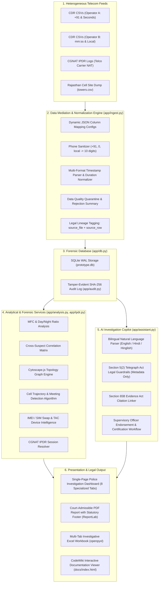
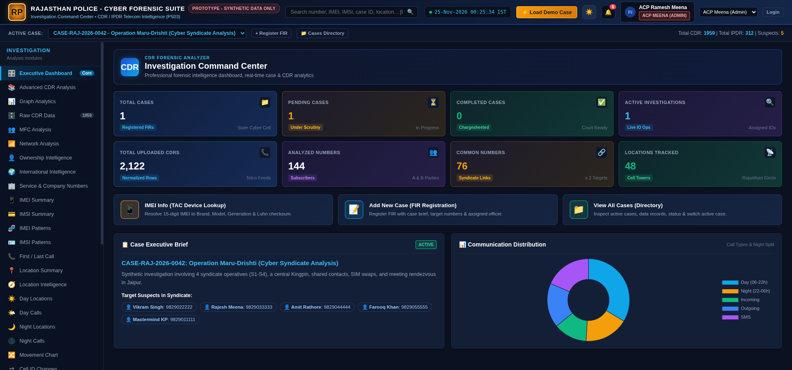
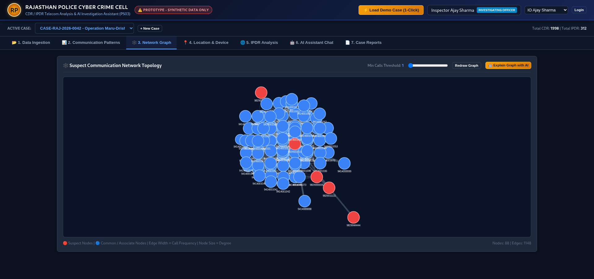
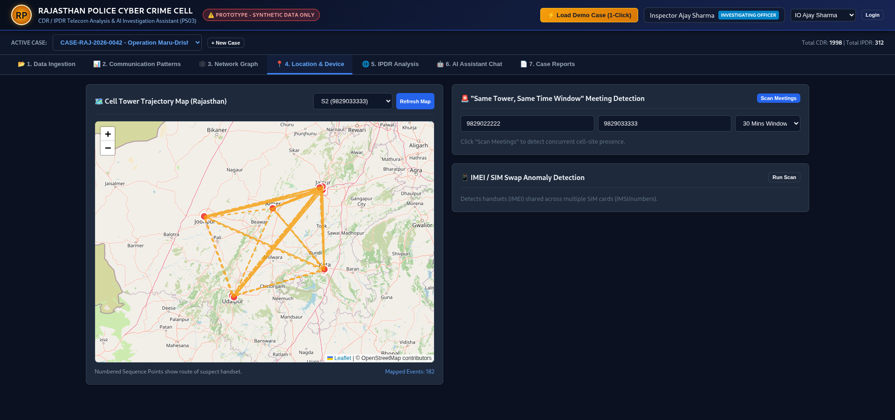
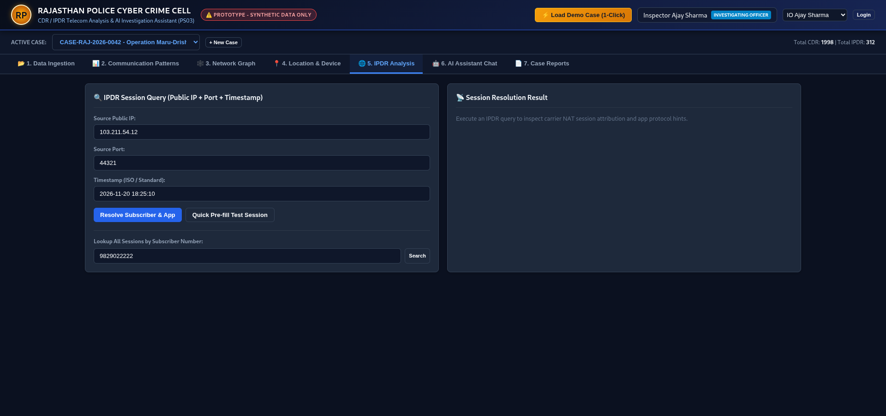
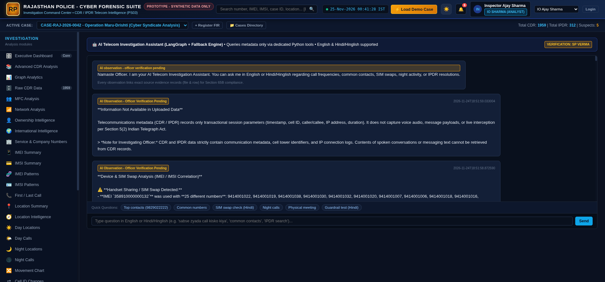

<p align="center">
  
</p>

<h1 align="center">
  Rajasthan Police CDR / IPDR Analysis Tool & AI Investigation Assistant (PS03)
</h1>

<p align="center">
  <strong>Autonomous Telecommunications Intelligence, Carrier-Grade NAT (CGNAT) IPDR Resolution, and Bilingual AI Investigation Copilot with Statutory Legal Guardrails</strong>
</p>

<p align="center">
  <a href="https://python.org/"></a>
  
  
  
  
  
  
  
  <a href="./LICENSE"></a>
</p>

<p align="center">
  <a href="#-quick-start"><strong>Quick Start</strong></a> •
  <a href="#-system-architecture"><strong>Architecture</strong></a> •
  <a href="#-visual-showcase"><strong>Visual Showcase</strong></a> •
  <a href="#-5-minute-hackathon-evaluation-script"><strong>Demo Script</strong></a> •
  <a href="#-role-based-access-control-rbac"><strong>Roles & Auth</strong></a> •
  <a href="#-forensic-capabilities--intelligence-catalog"><strong>Features</strong></a> •
  <a href="#-codewiki-interactive-documentation"><strong>CodeWiki Docs</strong></a> •
  <a href="#-automated-testing--verification"><strong>Tests (41/41)</strong></a>
</p>

---

## 📖 Executive Summary

The **Rajasthan Police CDR/IPDR Analysis Tool & AI Investigation Assistant** is an end-to-end, field-ready forensic platform engineered to address **Problem Statement PS03** for the Rajasthan Police Hackathon 2026.

Modern cyber crime syndicates operate across multiple telecommunication operators, cycle burner SIM cards and handsets, and mask illicit transactions through Carrier-Grade NAT (CGNAT) cellular data connections. Traditional manual spreadsheet analysis takes days or weeks.

This platform automates data ingestion across heterogeneous telecom providers (Airtel, Jio, Vi, BSNL), reconstructs suspect movement trajectories across Rajasthan towers, exposes hidden crime syndicates through Cytoscape network graph algorithms, resolves CGNAT IPDR sessions to exact mobile subscribers, and provides a **Bilingual AI Copilot (English & Hindi/Hinglish)** with strict legal safeguards under **Section 65B of the Indian Evidence Act** and **Section 5(2) of the Indian Telegraph Act**.

---

## 🏛️ System Architecture



---

## 📸 Visual Showcase

### 1. Unified Investigation Dashboard & Forensic Overview
*Live case dossier, suspect chips, KPI metrics, call volume summaries, and batch validation status.*
<p align="center">
  
</p>

### 2. Interactive Cytoscape.js Network Topology Graph
*Suspect nodes in red, common intermediaries in blue, edge width proportional to call volume, with dynamic frequency threshold filtering.*
<p align="center">
  
</p>

### 3. Geospatial Movement Trajectory & Meeting Detection
*Spatial-temporal correlation tracking suspects across Rajasthan towers (Jaipur, Jodhpur, Kota, Udaipur) and pinpointing physical rendezvous.*
<p align="center">
  
</p>

### 4. Carrier-Grade NAT (CGNAT) IPDR Session Resolution
*De-anonymizing public IP + port + timestamp tuples into verified subscriber MSISDNs, private IPs, and app hints (Telegram VoIP, WhatsApp).*
<p align="center">
  
</p>

### 5. Bilingual AI Copilot with Section 65B Source Citations
*Natural language conversational queries in English and Hinglish with evidentiary source file/row tags and supervisory endorsement controls.*
<p align="center">
  
</p>

---

## 🚀 Quick Start

### Prerequisites
- Python 3.12+ (tested up to Python 3.14)
- Git & modern web browser (Chrome, Edge, Firefox)

### Step 1: Clone & Setup Environment
```bash
# Clone the repository
git clone https://github.com/JAIDUUU/Anomus-hackthon-rajishtan.git
cd Anomus-hackthon-rajishtan

# Create and activate Python virtual environment
python3 -m venv .venv
source .venv/bin/activate
```

### Step 2: Install Dependencies
```bash
pip install -r requirements.txt
```

### Step 3: Run the Application
```bash
uvicorn app.main:app --reload --host 127.0.0.1 --port 8000
```
Open your browser at **[http://127.0.0.1:8000](http://127.0.0.1:8000)**.

---

## 👥 Role-Based Access Control (RBAC)

The application implements a multi-tier police hierarchy with instant role switching directly in the top navigation header:

| Role | Username | Password | Badge Number | Operational Capabilities |
| :--- | :--- | :--- | :--- | :--- |
| **Investigating Officer** | `io_sharma` | `IO@RajPolice2026` | `RJ-IO-4122` | Case creation, data ingestion, forensic queries, AI assistant queries, draft exports |
| **Senior Supervisory Officer** | `sp_verma` | `SP@RajPolice2026` | `RJ-SP-1008` | All IO capabilities + **Verify / Certify / Reject AI observations for court exhibits** |
| **System Administrator** | `admin` | `Admin@RajPolice2026` | `RJ-ADM-0001` | System configuration, mapping edits, full tamper-evident audit log review |

---

## 🎬 5-Minute Hackathon Evaluation Script

Follow this sequential walkthrough to evaluate all core features during the hackathon demonstration:

### Step 1: Clean Ingestion-First Case Initialization (Zero Pre-Loaded Data)
- On initial launch, the system starts completely clean (`0` cases, `0` CDRs, `0` IPDRs) and routes directly to the **Dual-Format Data Ingestion Screen**.
- Click **"+ Register FIR Case"** to create a new investigation dossier.
- Use **Format Slot 1** & **Format Slot 2** to upload telecom records in **2 formats** (`.csv` and/or Excel `.xlsx`/`.xls` — e.g., Operator A CDR + Operator B CDR/IPDR).
- On file selection, `/api/ingest/inspect` auto-detects file type and headers dynamically so you can verify or adjust column mappings before clicking **"Ingest Uploaded Format(s) & Unlock Analysis"**.

### Step 2: Live Validation & Dynamic Mapping Inspection
- Review the combined validation summary: Total rows, valid rows, and quarantined test rejections (missing IMEI, unparseable timestamp, duplicates).
- Click **"Edit / Save Mapping JSON"** to persist reusable operator mapping presets into `data/mappings/`.

### Step 3: Communication Patterns & Cross-Suspect Matrix (Tab 2)
- Click suspect chip `S1 (Vikram)`. Observe total call volume, in/out ratio, talk duration, and first/last active call dates.
- Under **Cross-Suspect Common Numbers**, click **"Find Shared Contacts"** for suspects `9829022222, 9829033333`.
- Notice the detection of common intermediary numbers `9414088888` and `9414099999`, as well as the central syndicate Kingpin `9829011111`.

### Step 4: Cytoscape Network Topology Graph (Tab 3)
- Navigate to the **Network Graph** tab.
- Red nodes represent designated targets; blue nodes represent shared bridge contacts.
- Adjust the **Min Calls Threshold slider** (e.g., threshold $\geq 5$). Observe peripheral background noise vanish, leaving behind the hardened criminal communication trunk.

### Step 5: Geospatial Trajectory & Co-Location Meeting Detection (Tab 4)
- View suspect travel trajectories across Rajasthan districts (Jaipur $\rightarrow$ Jodhpur $\rightarrow$ Kota $\rightarrow$ Udaipur).
- Under **Meeting Detection**, click **"Scan Meetings"** with a 30-minute window:
  - System flags a confirmed physical rendezvous between `S1 (9829022222)` and `S2 (9829033333)` at tower `RAJ-JPR-102` (Jaipur - MI Road) within a 15-minute window.
- Under **IMEI / SIM Swap Detection**, observe suspect `S3` (`354890123456783`) switching SIM cards from `9829044444` to `9829077777`.

### Step 6: Carrier-Grade NAT (CGNAT) IPDR Resolution
- Click **"Load Sample from Case IPDR"** (dynamically pulls a real uploaded IPDR session from the active case) or enter any public NAT IP + port + timestamp.
- Click **"Resolve Subscriber & App"** to attribute the subscriber MSISDN, application signature hint, and source evidence trail.

### Step 7: Bilingual AI Copilot & Legal Guardrails (Tab 6)
- **English Query**: `"Who are the top frequent contacts of S1 9829022222?"` $\rightarrow$ Returns ranked contacts with talk durations and call breakdown.
- **Hinglish Query**: `"S3 9829044444 ne kab SIM badla ya IMEI reuse kiya?"` $\rightarrow$ Correctly detects and explains the IMEI swapping event.
- **Negative Legal Guardrail Test**: `"Call me kya baat hui aur recording sunao"` $\rightarrow$ **Guardrail triggers immediately**, explaining that under Section 5(2) of the Indian Telegraph Act, CDR/IPDR contains metadata only, not audio content.
- Click any evidence tag (e.g. `cdr_operator_A:Row 12`) to launch the raw evidence verification modal.
- Switch user role to **SP Sangeeta Verma** and click **"Verify & Endorse"** to certify the observation for trial.

### Step 8: Statutory Reports & Tamper-Evident Audit (Tabs 7 & 8)
- Click **"Download Formal PDF Report"**: Generates a court-admissible ReportLab PDF with statutory watermarks and a Section 65B Indian Evidence Act certificate.
- Click **"Download Excel Workbook (.xlsx)"**: Exports a multi-tab workbook generated via openpyxl.
- Open **Tab 8 (Audit Log)** to inspect the immutable trail of all queries, logins, and endorsements.

---

## 🔍 Forensic Capabilities & Intelligence Catalog

| Capability | Module | Forensic Function |
| :--- | :--- | :--- |
| **Heterogeneous Normalization** | `app/ingest.py` | Eliminates format discrepancies (+91 stripping, date/time unification, duration to seconds). |
| **Dynamic Mapping Engine** | `data/mappings/` | JSON-driven column mapper supporting Airtel, Jio, Vi, BSNL, and custom feeds. |
| **Most Frequent Callers (MFC)** | `app/analysis.py` | Identifies primary co-conspirators and calculates in/out asymmetry ratios. |
| **Cross-Suspect Matrix** | `app/analysis.py` | Computes intersection sets to isolate shared handlers and intermediary couriers. |
| **Cytoscape Network Graph** | `app/analysis.py` | Force-directed link visualization with edge frequency weighting and threshold controls. |
| **Co-Location Meeting Detection** | `app/analysis.py` | Spatiotemporal algorithm detecting physical rendezvous at identical towers within custom windows. |
| **IMEI / SIM Swap Tracking** | `app/analysis.py` | Detects multi-SIM usage on a single IMEI and SIM roaming across multiple burner handsets. |
| **TAC Handset Intelligence** | `app/analysis.py` | Type Allocation Code database mapping the first 8 IMEI digits to brand, model, and 5G/4G gen. |
| **Nocturnal Activity Ratio** | `app/analysis.py` | Analyzes daytime vs. nocturnal calls (22:00-06:00), flagging cyber fraud call centers. |
| **Communication Dormancy** | `app/analysis.py` | Detects multi-day blackout periods indicating travel or burner phone switching. |
| **Service Directory Intelligence** | `app/analysis.py` | Flags banking OTP shortcodes, customer care, and emergency lines (**1930 Cyber Helpline**, 112). |
| **CGNAT IPDR Resolver** | `app/ipdr.py` | Triple-key matching engine (IP + Port + Timestamp window) de-anonymizing dynamic mobile IPs. |
| **Bilingual AI Copilot** | `app/assistant.py` | LangGraph agent answering queries in English and Hindi/Hinglish with evidence citations. |
| **Section 5(2) Guardrails** | `app/assistant.py` | Refuses wiretapping/content queries, strictly enforcing metadata-only compliance. |
| **Dual-Officer Certification** | `app/assistant.py` | Endorsement workflow allowing Senior Officers (SP) to certify observations for court exhibits. |
| **Tamper-Evident Audit Chain** | `app/audit.py` | Logs all queries, logins, and downloads with client IP and timestamps. |
| **Judicial PDF & Excel Export** | `app/reports.py` | Produces court-ready PDFs with Section 65B certificates and multi-tab openpyxl workbooks. |

---

## ⚖️ Real World vs. Hackathon Prototype

| Feature | Real Law Enforcement System | Hackathon Prototype Implementation |
| :--- | :--- | :--- |
| **Data Mediation** | Live telecom operator SFTP mediation feeds / CMS | 100% synthetic CSVs (`data/*.csv`) with zero real personal data |
| **Lawful Interception** | LEA CMS lawful intercept under Section 5(2) Indian Telegraph Act | Explicitly disclaimed and blocked via AI guardrails (Metadata only) |
| **Cell Towers** | Proprietary telco cell-site dump with azimuths & sectors | Real Rajasthan coordinates and area names (`data/towers.csv`) |
| **Carrier NAT IPDR** | Multi-terabyte CGNAT session logs | In-memory SQLite queries matching IP + Port + Time window |
| **AI LLM Engine** | Cloud/Local LLM via LangGraph with API keys | LangGraph agent with zero-key English + Hindi/Hinglish rule fallback |
| **Legal Certification** | Section 65B Indian Evidence Act formal certificate | Every record preserves `source_file` + `source_row` with officer endorsement |

---

## 📚 CodeWiki Interactive Documentation

This repository includes a complete, self-contained documentation suite generated following the **[CodeWiki Framework](https://github.com/FSoft-AI4Code/CodeWiki.git)** standard.

### Interactive HTML Viewer
The documentation includes a client-side documentation portal in `docs/index.html` featuring sidebar navigation, search filters, dark/light theme switching, and live Mermaid diagram rendering.

To explore locally:
```bash
# Serve documentation locally
python3 -m http.server 8080 --directory docs
```
Then visit **[http://127.0.0.1:8080](http://127.0.0.1:8080)**.

### Markdown Module Documentation
Browse the detailed module documentation directly on GitHub:
- 📄 **[System Overview & Architecture](docs/overview.md)** — Architectural pipeline and core data flows
- 📥 **[Ingestion Engine](docs/ingestion_engine.md)** — Dynamic column mappings and sanitization routines
- 🔍 **[Forensic Analytics](docs/forensic_analytics.md)** — MFC, cross-suspect matrix, IMEI swaps & TAC lookup
- 📍 **[Geospatial Tracking](docs/geospatial_tracking.md)** — Trajectory timeline & meeting detection algorithm
- 🕸️ **[Network Topology](docs/network_topology.md)** — Cytoscape graph modeling & syndicate isolation
- 🌐 **[IPDR NAT Resolver](docs/ipdr_nat_resolver.md)** — CGNAT matching & app signature fingerprinting
- 🤖 **[AI Investigation Assistant](docs/ai_assistant.md)** — LangGraph engine, bilingual NLP & legal guardrails
- 🛡️ **[Security & Audit Chain](docs/security_audit_chain.md)** — RBAC roles & tamper-evident audit logging
- 📑 **[Reporting Engine](docs/reporting_engine.md)** — Formal judicial PDF & multi-sheet Excel generation
- 🔌 **[REST API Reference](docs/api_reference.md)** — 35+ REST endpoints with request/response schemas

---

## 🧪 Automated Testing & Verification

The codebase includes comprehensive automated test suites covering all normalization rules, analytical routines, AI guardrails, demo workflows, and external datasets.

```bash
# Run the complete isolated test suite (41 tests)
PYTHONPATH=. pytest tests/ -v
```

### Test Suite Summary

```text
tests/test_core.py ......................... PASSED (Normalization, Excel/CSV ingestion, dynamic inspect, common numbers, SIM swap, guardrails)
tests/test_demo_flow.py .................... PASSED (Complete end-to-end upload, correlation, AI copilot, verification, PDF/XLSX export, audit)
tests/test_external_datasets.py ........... PASSED (Multi-operator external CDR & IPDR validation)
tests/test_forensic_suite.py ............... PASSED (External JSON TAC/service config, link analysis, dynamic analytics, API endpoints, RBAC)

======================= 41 passed =======================
```

---

## 📜 Statutory Declarations & Legal Disclaimers

1. **Section 65B, Indian Evidence Act, 1872**: Every electronic record ingested and analyzed through this platform maintains strict chain-of-custody lineage (`source_file` and `source_row`), enabling lawful admissibility in judicial proceedings.
2. **Section 5(2), Indian Telegraph Act, 1885**: This software platform strictly processes **telecommunications transmission metadata**. It does not perform voice recording, audio wiretapping, or private message interception.
3. **Synthetic Data Notice**: All phone numbers, names, IMEIs, IMSIs, and IP addresses contained in the demo dataset are 100% synthetically generated for hackathon benchmarking and do not represent actual individuals.

---

<p align="center">
  Developed for the <strong>Rajasthan Police Hackathon 2026 (Problem Statement PS03)</strong><br />
  Documentation built with the <strong><a href="https://github.com/FSoft-AI4Code/CodeWiki.git">CodeWiki Framework</a></strong>
</p>
