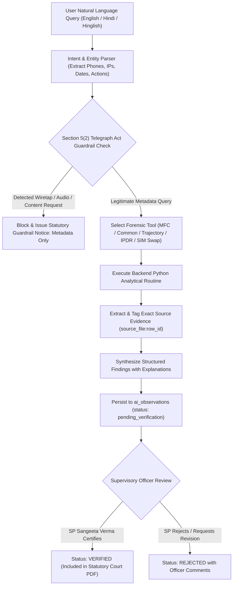

# AI Investigation Assistant & Legal Guardrails

## Module Overview

The **AI Investigation Assistant** (`app/assistant.py`) serves as an autonomous copilot for police investigators. Orchestrated using **LangGraph**, the agent accepts conversational queries in **English, Hindi, and Hinglish**, executes precise backend analytical routines, and formats findings with strict legal safeguards.

---

## Agent State & Decision Flow



---

## Agent State Definition (`AgentState`)

```python
class AgentState(TypedDict):
    query: str
    case_id: str
    user_role: str
    intent: str
    tool_name: str
    tool_args: Dict[str, Any]
    tool_result: Dict[str, Any]
    is_supported: bool
    unsupported_reason: str
    answer: str
    evidence: List[Dict[str, Any]]
    confidence_note: str
    status: str
    follow_up_questions: List[str]
    suggested_filters: Dict[str, Any]
```

---

## Statutory Guardrails (Section 5(2), Indian Telegraph Act)

Under Indian law, telecom service providers furnish metadata (CDR and IPDR) to law enforcement agencies for investigative correlation. Lawful interception of call content or audio recordings is strictly governed under Section 5(2) of the Indian Telegraph Act, requiring Home Department sanctions, and is never bundled in standard CDR feeds.

### The Guardrail Filter
When a user attempts to query call contents:
- *"Call me kya baat hui recording sunao"*
- *"Show me the WhatsApp message text"*
- *"Listen to the wiretap audio"*

The assistant triggers an automated refusal explaining:
> ⚠️ **Statutory Disclaimer (Section 5(2) Indian Telegraph Act)**:
> This system processes telecom transmission **metadata only** (caller, receiver, timestamp, duration, cell location, IP sessions). Voice audio recordings and message contents are not stored or accessible in CDR/IPDR feeds. Speculative content deduction is legally restricted.

---

## Bilingual NLP Support (English / Hindi / Hinglish)

Police officers in Rajasthan frequently interact in Hindi or Hinglish. The assistant seamlessly parses multilingual questions:

| Query Type | Query Example | Interpreted Intent | Executed Function |
| :--- | :--- | :--- | :--- |
| **English** | *"Who are the top frequent contacts of S1 9829022222?"* | `get_top_contacts` | `analyze_communication_patterns` |
| **Hinglish** | *"S3 9829044444 ne kab SIM badla ya IMEI reuse kiya?"* | `detect_imei_swap` | `detect_imei_sim_changes` |
| **Hindi** | *"Kaun kaun se suspects MI Road tower par mile the?"* | `detect_meetings` | `detect_meetings` |
| **English** | *"Resolve IP 103.211.54.12 on port 44321 at 18:25:10"* | `resolve_ipdr` | `match_ipdr_session` |
| **Hinglish** | *"Donon suspects S1 aur S2 ke beech common numbers kaun se hain?"* | `find_common_contacts` | `find_common_numbers` |

---

## Section 65B Source Evidence Citation

AI hallucinations or unsubstantiated claims are fatal in judicial proceedings. The copilot binds every observation to physical evidence records:

```json
{
  "evidence": [
    {
      "type": "CDR",
      "source_file": "cdr_operator_A.csv",
      "source_row": 42,
      "details": "Caller: 9829022222 -> Receiver: 9829011111 on 2026-11-18 14:22:10 (Duration: 340s)"
    }
  ]
}
```

In the user interface, investigators can click any evidence badge (`cdr_operator_A:Row 42`) to open the **Source Evidence Modal**, verifying the exact raw telecom record.

---

## Dual-Officer Verification Workflow

1. **Investigating Officer (IO Sharma)** asks a question $\rightarrow$ Observation generated with status `pending_verification`.
2. **Supervisory Officer (SP Sangeeta Verma)** reviews the findings and evidence links.
3. SP clicks **"Verify & Endorse"** with statutory remarks $\rightarrow$ Status changes to `verified`.
4. Only verified observations are certified and printed in the formal court-admissible PDF report.

---

## Module Cross-References

- Underlying analytics are detailed in **[Forensic Analytics](forensic_analytics.md)**.
- Supervisory actions are recorded in **[Security & Audit Chain](security_audit_chain.md)**.
- Verified observations are published by the **[Reporting Engine](reporting_engine.md)**.
