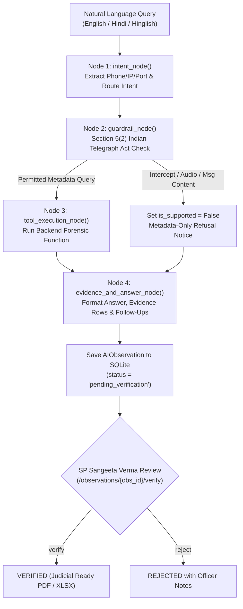

# AI Investigation Assistant & Legal Guardrails

## Module Overview

The **AI Investigation Assistant** (`app/assistant.py`) is an agentic copilot orchestrated via **LangGraph** (`StateGraph`). It accepts natural-language queries in **English, Hindi, and Hinglish**, routes intents dynamically against live database evidence for the active FIR case, binds every claim to **Section 65B source citations**, enforces **Section 5(2) Indian Telegraph Act metadata-only guardrails**, and queues every AI observation for **Supervisory Officer verification**.

---

## LangGraph Execution Pipeline (`build_investigation_graph`)



---

## Agent State Schema (`AgentState`)

```python
class AgentState(TypedDict):
    query: str
    case_id: str
    user_role: str
    intent: str
    tool_name: str
    tool_args: Dict[str, Any]
    tool_result: Dict[str, Any]
    is_supported: bool
    unsupported_reason: str
    answer: str
    evidence: List[Dict[str, Any]]
    confidence_note: str
    status: str
    follow_up_questions: List[str]
    suggested_filters: Dict[str, Any]
```

---

## Supported Intents & Bilingual NLP Routing (`detect_intent_rule_based`)

Using regex entity extractors (`extract_phone_numbers` for 10-digit Indian MSISDNs and `extract_ip_and_port` for IPv4/port tuples), the router dispatches multilingual officer queries to verified Python backend routines:

| Interpreted Intent | Sample Bilingual Keywords | Executed Backend Function | Dynamic Context Fallback |
| :--- | :--- | :--- | :--- |
| **`unsupported`** | `"recording"`, `"sunao"`, `"kya baat hui"`, `"call content"`, `"live location"`, `"whatsapp message content"` | `guardrail_unsupported` | Enforces Section 5(2) statutory boundary |
| **`ipdr_lookup`** | IPv4 pattern or `"ipdr"`, `"ip address"`, `"public ip"` | `match_ipdr_session` | If IP/timestamp omitted, dynamically pulls active case's uploaded `IPDRRecord` session |
| **`meeting_detection`** | `"meeting"`, `"mile the"`, `"kahan mile"`, `"same tower"`, `"rendezvous"` | `detect_meetings` | Uses extracted 2 numbers or top 2 suspects from `get_ordered_suspects_for_case` |
| **`imei_sim_changes`** | `"sim swap"`, `"imei change"`, `"handset badla"`, `"sim badla"` | `detect_imei_sim_changes` | Evaluates case-wide multi-SIM / multi-IMEI swaps |
| **`common_numbers`** | `"common"`, `"mutual"`, `"dono se baat"`, `"shared contact"` | `find_common_numbers` | Intersects suspect pair contact networks |
| **`night_activity`** | `"night"`, `"raat"`, `"der raat"`, `"odd hours"` | `analyze_communication_patterns` | Profiles nocturnal call ratio (`22:00–05:59`) |
| **`location_timeline`** | `"tower"`, `"location"`, `"kahan gaya"`, `"route"`, `"path"` | `get_location_timeline` | Extracts chronological BTS movement history |
| **`frequent_contacts`** | `"frequent"`, `"top contact"`, `"sabse jyada"`, `"most called"` | `analyze_communication_patterns` | Ranks top peers, talk time, and asymmetry |
| **`explain_view`** | `"explain"`, `"chart"`, `"graph"`, `"samjhao"` | `case_overview` | Summarizes uploaded case overview |

---

## Mandatory Statutory Controls

1. **Section 5(2) Indian Telegraph Act Metadata Guardrail:** Requests seeking spoken call audio, SMS/WhatsApp message body text, or live GPS interception immediately trigger `is_supported = False` and explain that CDR/IPDR records strictly store transmission metadata.
2. **Zero-Hallucination Section 65B Lineage:** Every observation persists JSON-serialized source pointers (`source_file`, `source_row`) from matching DB records into `ai_observations`.
3. **Human-in-the-Loop Supervisory Gate:** Observations default to `"pending_verification"` (`confidence_note: "AI observation - officer verification pending"`) until a Senior Officer (`require_role("senior_officer")`) submits `"verify"` or `"reject"` via `POST /api/cases/{case_id}/observations/{obs_id}/verify`.
