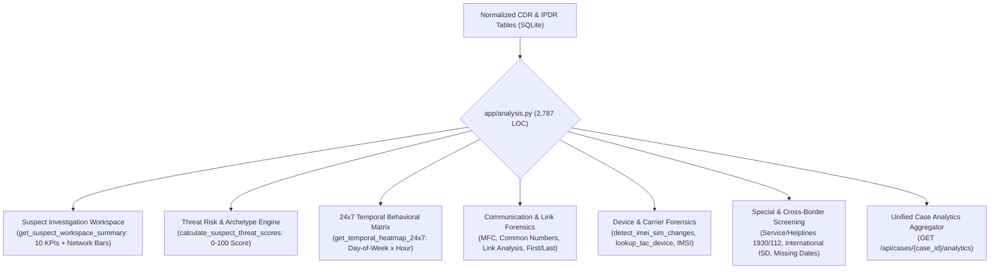

# Forensic Analytics & Intelligence Engine

## Module Overview

The **Forensic Analytics & Intelligence Engine** (`app/analysis.py`, **2,787 lines**) powers the investigative backend across **28 UI analysis modules**, combining telecom traffic aggregation, suspect risk scoring, device/SIM fingerprinting, 24×7 behavioral matrices, and cross-case entity lookups.

Every analytical routine operates directly against persisted SQLite records (`CDRRecord`, `IPDRRecord`, `CellTower`, `Case`), returning `source_file:source_row` citations for Section 65B admissibility.

---

## Analytics Subsystems Architecture

---

## Key Capabilities & Algorithms

### 1. Suspect Investigation Workspace (`get_suspect_workspace_summary`)
Powers the per-suspect forensic overview via `GET /api/cases/{case_id}/suspect/{phone}/summary`:
- **10 KPI Summary Metrics:** `total_rows`, `total_calls`, `total_sms`, `total_contacts`, `total_imeis`, `total_imsis`, `total_locations`, `total_active_days`, `international_contacts`, `ownership_found`.
- **Real Ownership Resolution:** Matches counter-party numbers dynamically against `data/config/service_directory.json`, case `brief_data` suspect profiles, and `raw_data_json` metadata (`Subscriber Name`, `Owner Name`, `B_Name`) instead of placeholder counters.
- **Network Operator Distribution:** Computes color-coded carrier breakdown percentages across **Jio**, **Airtel**, **Vi**, **BSNL**, **International**, and **Service** prefixes.

### 2. Multi-Factor Suspect Threat Risk Scoring (`calculate_suspect_threat_scores`)
Assigns every active target a dynamic **0–100 Threat Score**, categorical `risk_level` (`LOW` / `MEDIUM` / `HIGH` / `CRITICAL`), and behavioral `archetype` starting from a baseline of `10` points:

| Behavioral Indicator | Scoring Rule | Max Impact | Forensic Signal |
| :--- | :--- | :---: | :--- |
| **Nocturnal Activity Ratio** | ≥ 40% night calls (`22:00–05:59`) → **+25 pts**; ≥ 25% → **+15 pts** | +25 | Call-center fraud, late-night drops, extortion coordination |
| **SIM Swapping / IMEI Hopping** | Multi-SIM IMEI or Multi-IMEI SIM detected via `detect_imei_sim_changes` | +30 | Anti-surveillance burner rotation |
| **Impossible Terrestrial Velocity** | Sequential tower hops flagged `is_suspicious_speed` (`> 150 km/h`) | +20 | Cloned SIM / shared credential anomaly |
| **International Contacts** | Direct ISD dialing (`+`, `00`, length > 11) via `is_international_number` | +15 | Cross-border handlers / offshore operators |
| **Common Syndicate Bridges** | Shares ≥ 2 intermediary contacts with other suspects | +10 | Core syndicate handler / broker role |

### 3. 24×7 Temporal Behavioral Heatmap (`get_temporal_heatmap_24x7`)
Builds a 7-day × 24-hour matrix (Monday–Sunday × `00–23` IST) computing per-hour density peaks for a target phone or entire case via `GET /api/cases/{case_id}/heatmap`.

### 4. Most Frequent Callers (MFC) & Direct Link Analysis
- **`get_mfc_analysis`:** Aggregates incoming/outgoing/SMS counts, cumulative talk-time duration, and distinct towers per peer contact.
- **`analyze_link_between_numbers` (`GET /api/cases/{case_id}/link-analysis?num1=...&num2=...`):** Profiles bilateral links between any two MSISDNs including direct call frequency, shared common associates, common cell towers, and chronological shared interactions.
- **`find_common_numbers`:** Intersects contact graphs across 2+ suspect phones to surface hidden syndicate hubs/kingpins with row-level evidence citations.

### 5. IMEI / SIM Swap & TAC Handset Intelligence
- **`detect_imei_sim_changes`:**
  - *1 IMEI → Multiple SIMs:* Identifies burner/cloned hardware reused across different numbers.
  - *1 SIM → Multiple IMEIs:* Tracks a target MSISDN migrating across phones.
- **`lookup_tac_device` (`/api/tac/{imei}`):** Resolves the 8-digit Type Allocation Code against `data/config/tac_database.json` and prefix heuristics to return handset OEM, model, form factor, and radio capability (5G/4G VoLTE/Feature Phone).

### 6. Temporal & Special Screening (`app/analysis.py` + `app/main.py`)
- **Day vs. Night Forensics (`get_day_night_analysis`):** Splits daytime (`06:00–21:59`) vs nocturnal (`22:00–05:59`) voice/SMS traffic and exposes dedicated UI tables (`day-calls`, `night-calls`, `day-locations`, `night-locations`).
- **First / Last Contact Bounds (`get_first_last_calls`):** Establishes earliest & latest peer interaction windows with duration totals.
- **Dormancy & Radio Silence (`get_missing_dates_analysis`):** Flags zero-activity calendar gaps between first and last observed CDR timestamps.
- **Service & Banking Directory (`get_service_and_company_numbers`):** Identifies victim/suspect interactions with banking IVRs, **1930 Cyber Helpline**, **112 Police ERSS**, Railway 139, and SMS gateways loaded from `data/config/service_directory.json`.
- **International Dialing (`get_international_intelligence`):** Parses country dialing codes (`+971`, `+44`, `+1`, etc.) and tags offshore risk zones.
- **Unified Case Analytics (`GET /api/cases/{case_id}/analytics`) & Global Lookup (`GET /api/lookup`, `GET /api/search`, `GET /api/cases/{case_id}/search`):** Computes and serves all 28 modules plus fuzzy cross-entity lookup across phone numbers, IMEIs, IMSIs, IP addresses, and BTS towers.
