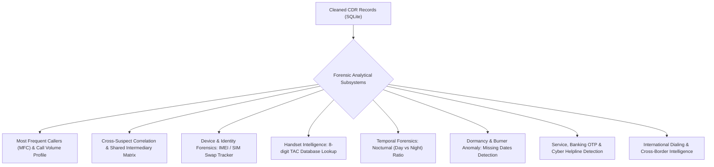
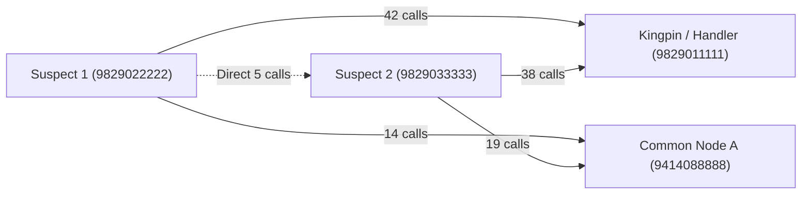

# Forensic Analytics & Intelligence Engine

## Module Overview

The **Forensic Analytics & Intelligence Engine** (`app/analysis.py`) contains over 2,000 lines of specialized telecom forensic algorithms. It transforms raw CDR records into actionable intelligence for cyber crime units, anti-gang task forces, and organized crime investigators.

---

## Analytics Architecture

---

## Key Forensic Capabilities

### 1. Most Frequent Callers (MFC) & Communication Profiling
- Aggregates call frequency, incoming/outgoing distribution, and cumulative duration per contact.
- Formulates the **In/Out Asymmetry Index**:
  $$\text{Asymmetry} = \frac{\text{Outgoing Calls} - \text{Incoming Calls}}{\text{Total Calls}}$$
  High positive asymmetry indicates command-and-control behavior (dispatching orders), while high negative asymmetry indicates customer-facing or drop-point roles.

### 2. Cross-Suspect Common Numbers Matrix
- Takes a list of multiple suspect phone numbers (e.g., $S_1, S_2, S_3$).
- Computes intersection sets to isolate:
  - **Direct Links**: Direct calls between targets.
  - **Shared Intermediary Contacts**: Third-party numbers contacted by two or more suspects, uncovering handlers, couriers, or kingpins.

### 3. IMEI & SIM Swap Anomaly Detection (`detect_imei_sim_changes`)
Criminals routinely discard SIM cards while retaining handsets, or conversely, rotate burner handsets with a single master SIM.

1. **One IMEI $\rightarrow$ Multiple SIMs (Handset Sharing / SIM Cycling)**:
   - Identifies an identical IMEI registering multiple distinct phone numbers (`a_number`).
   - Flags equipment reuse in criminal operations.
2. **One SIM $\rightarrow$ Multiple IMEIs (Handset Swapping / Burner Use)**:
   - Identifies a single MSISDN roaming across multiple hardware devices.
   - Detects when a suspect upgrades or switches devices during an ongoing operation.

### 4. Type Allocation Code (TAC) Handset Intelligence
- Extracts the first 8 digits of the 15-digit IMEI.
- Matches against the embedded `TAC_DATABASE` comprising Apple, Samsung, OnePlus, Xiaomi, Vivo, Oppo, Google, and feature phone models.
- Returns device manufacturer, brand, commercial model, and cellular generation (e.g., *Apple iPhone 15 Pro Max - 5G VoNR*).

### 5. Day vs. Night Ratio Analysis (`get_day_night_analysis`)
- Partitions 24-hour activity into:
  - **Daytime Window**: 06:00:00 to 21:59:59
  - **Night Window**: 22:00:00 to 05:59:59
- Flags high **Night Activity Ratio** (>35%):
  $$\text{Night Ratio} = \frac{\text{Night Calls}}{\text{Total Calls}} \times 100\%$$
  Unusually high nocturnal activity is a proven indicator of cyber fraud call centers, narcotics logistics, or extortion rings.

### 6. Missing Dates & Communication Dormancy (`get_missing_dates_analysis`)
- Scans chronological call history to detect consecutive days with zero CDR events.
- Pinpoints "radio silence" periods corresponding to:
  - Travel dates (suspect crossing states without mobile usage).
  - Use of burner secondary devices.
  - Temporary operational halts post-incident.

### 7. Service Numbers & Banking Directory Lookup
- Compares called parties against the `SERVICE_DIRECTORY`:
  - Banking Gateways & IVRs (SBI, HDFC, ICICI, PNB, Canara).
  - Law Enforcement Helplines (**1930 Cyber Crime Reporting**, **112 ERSS**, **1090 Women Helpline**).
  - Carrier Support (121, 198) and OTP Gateways (56161).
- Uncovers victim contact attempts or banking fraud activities prior to cash withdrawal.

### 8. Global Forensic Search (`global_search`)
- Performs high-speed multi-attribute indexing across phone numbers, IMEIs, IMSIs, cell towers, and source file metadata.

---

## Module Cross-References

- Network connections generate graphs in **[Network Topology](network_topology.md)**.
- Spatiotemporal coordinates link to **[Geospatial Tracking](geospatial_tracking.md)**.
- Analytics feed the **[AI Investigation Assistant](ai_assistant.md)** for conversational triage.
