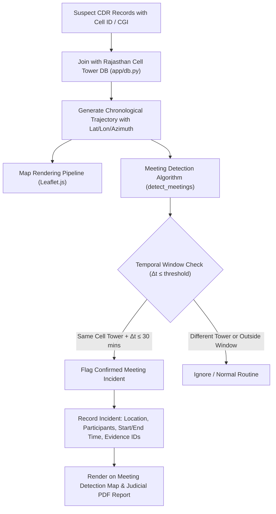

# Geospatial Tracking & Co-Location Detection

## Module Overview

The **Geospatial Tracking & Co-Location Detection Engine** (`app/analysis.py`, `app/db.py`) correlates telecommunication metadata with geographic cell site data across Rajasthan districts (Jaipur, Jodhpur, Udaipur, Kota, Ajmer, Bikaner, Alwar).

It enables investigators to:
1. Reconstruct chronological movement trajectories for any target.
2. Identify physical co-location and secret meetings between suspects using spatiotemporal proximity algorithms.
3. Detect anomalous rapid movement and inter-district hops.

---

## Architectural Workflow



---

## Cell Site Master Model (`CellTower`)

Stored in `prototype.db` and populated via `data/towers.csv`:
```python
class CellTower(Base):
    __tablename__ = "cell_towers"

    id = Column(Integer, primary_key=True, index=True)
    cell_id = Column(String(50), unique=True, index=True, nullable=False)
    lac = Column(Integer, default=0)
    lat = Column(Float, nullable=False)
    lon = Column(Float, nullable=False)
    area_name = Column(String(150), nullable=False)
```

Example tower coordinates in Rajasthan:
- `RAJ-JPR-101`: MI Road, Jaipur ($26.9124^\circ\text{N}, 75.7873^\circ\text{E}$)
- `RAJ-JPR-102`: Vaishali Nagar, Jaipur ($26.9056^\circ\text{N}, 75.7420^\circ\text{E}$)
- `RAJ-JDH-201`: Clock Tower / Sardar Market, Jodhpur ($26.2968^\circ\text{N}, 73.0232^\circ\text{E}$)
- `RAJ-UDR-301`: City Palace / Lake Pichola, Udaipur ($24.5764^\circ\text{N}, 73.6835^\circ\text{E}$)
- `RAJ-KOT-401`: Aerodrome Circle, Kota ($25.1524^\circ\text{N}, 75.8342^\circ\text{E}$)

---

## Spatiotemporal Co-Location Algorithm

The `detect_meetings` routine identifies physical convergence without requiring GPS access by leveraging mobile cell registrations.

### Mathematical Formulation
Given two events $E_i = (S_1, \text{Cell}_A, t_i)$ and $E_j = (S_2, \text{Cell}_B, t_j)$ where $S_1 \neq S_2$:
1. **Spatial Proximity Constraint**:
   $$\text{Cell}_A = \text{Cell}_B$$
2. **Temporal Window Constraint**:
   $$|t_i - t_j| \leq \Delta T_{\text{window}} \quad (\text{default: } 30\text{ minutes})$$

When both constraints hold, an incident candidate is generated. Overlapping candidates within the same time window are merged into an ongoing physical meeting session.

### Python Implementation Snippet
```python
def detect_meetings(case_id: str, time_window_minutes: int = 30, db: Session = None):
    # Retrieve all timestamp-ordered CDR records associated with cell towers
    records = db.query(CDRRecord, CellTower).join(
        CellTower, CDRRecord.cell_id == CellTower.cell_id
    ).filter(CDRRecord.case_id == case_id).order_by(CDRRecord.start_time.asc()).all()

    meetings = []
    # Slide time window across records sharing identical cell_id
    # Record participants, start_time, end_time, and source evidence IDs
    return meetings
```

---

## Movement Trajectory & Inter-District Analysis

The `get_movement_and_cell_changes` function analyzes tower hops to identify:
- **Travel Velocity**: Detects physical travel between distinct cities (e.g., Jaipur to Jodhpur) within plausible transit windows.
- **Base Tower Identification**: Computes the mode of cell site registrations between 23:00 and 06:00 to establish the suspect's primary residence/hideout.
- **Operational Tower Identification**: Computes the daytime tower cluster where criminal calls and drop transactions take place.

---

## Module Cross-References

- Co-location findings are embedded into **[AI Investigation Assistant](ai_assistant.md)** for contextual queries.
- Meeting tables are automatically rendered into **[Reporting Engine](reporting_engine.md)** PDF reports.
