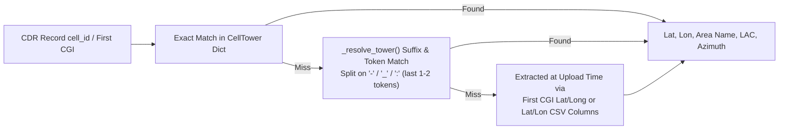

# Geospatial Tracking & 7-Mode Police GIS Engine

## Module Overview

The **Geospatial Tracking Engine** (`app/analysis.py`, `app/ingest.py`, `app/reports.py`, `app/static/app.js`) transforms raw telecom cell tower IDs (`Cell_ID`, `First CGI`, `Last CGI`) into an interactive **Leaflet.js 7-Mode Tactical GIS Workspace** with chronological route playback and **Google Earth KML/KMZ** mission exports.

---

## CGI-Aware Tower Resolution & Auto-Upsert Pipeline

Real telecom LEA CDR logs frequently provide hierarchical Common Global Identities (CGIs) like `404-45-4012-RAJJPR104` or `404-45-4012-40121` alongside shorthand IDs like `RAJ-JPR-104`.

- **`_resolve_tower(cell_id, towers_dict)` & `_resolve_tower_name(...)`:** Performs exact key lookup followed by delimiter-split token/suffix matching (`-`, `_`, `:`) so full CGIs reliably bind to BTS coordinates.
- **Automatic Inline Tower Discovery:** During CDR CSV/Excel ingestion (`ingest_cdr_data`), coordinates in `First CGI Lat/Long` (e.g. `26.903/75.742`), `Lat`/`Lon`, and `Tower Address` are parsed and upserted directly into SQLite `cell_towers`.

---

## 7 Tactical Police GIS Map Modes (`geo-map`)

Investigators can switch seamlessly among **7 live GIS overlays** powered by real uploaded evidence:

| Map Mode | Backend Endpoint / Function | Investigative Purpose |
| :--- | :--- | :--- |
| **1. Cell Towers Pin** | `GET /api/cases/{case_id}/towers/timeline` | Plots all geo-located BTS towers visited by targets with operator, LAC, hit count, and area tooltips |
| **2. Density Heatmap** | `GET /api/cases/{case_id}/towers/timeline` | Highlights spatial dwell-time hotspots based on call/SMS tower hit density |
| **3. Route Trajectory + Scrubber** | `GET /api/cases/{case_id}/movement` | Draws chronological polylines with interactive **Play / Pause / Timeline Scrubber** replay showing suspect movement step by step |
| **4. Day vs. Night Clusters** | `GET /api/cases/{case_id}/analytics` (`day_locations`, `night_locations`) | Contrasts daytime (`06:00–21:59`) workplace/commercial zones against nocturnal (`22:00–05:59`) likely safe-house/residential BTS towers |
| **5. Sector Azimuth Cones (65°)** | `GET /api/cases/{case_id}/towers/sectors` (`get_tower_sector_cones`) | Projects directional 65° beamwidth sector polygons (`1.2 km` radius across `0°/120°/240°` azimuths) showing approximate RF coverage arcs |
| **6. Co-Location Meetings** | `GET /api/cases/{case_id}/meetings` (`detect_meetings`) | Highlights exact towers where two suspects triggered events within a configurable time window (`time_window_minutes`, default `30`) |
| **7. Velocity Anomaly Alerts** | `GET /api/cases/{case_id}/velocity-anomalies` (`get_velocity_anomalies`) | Flags impossible terrestrial travel between sequential tower hops where speed exceeds `max_speed` (`120.0 km/h` default) and `dist_km > 20 km` |

---

## Key Spatial Algorithms

### 1. Haversine Distance & Velocity Anomaly Filtering (`get_velocity_anomalies`)
Using spherical earth distance (`R = 6371.0 km`), the engine calculates inter-tower velocity for consecutive records of a subscriber:
$$v = \frac{\text{haversine\_km}(\phi_1, \lambda_1, \phi_2, \lambda_2)}{\Delta t_{\text{hours}}}$$
- **Flight False-Positive Suppression:** Transitions where both endpoints contain `"Airport"` in `tower.area_name` are excluded automatically as commercial aviation transits.
- **SIM Cloning Indicator:** Sustained ground velocities exceeding `max_speed_kmh` (e.g., jumping Jaipur → Jodhpur in 15 minutes) alert the officer to cloned SIM credentials or simultaneous physical device sharing.

### 2. Spatiotemporal Co-Location (`detect_meetings`)
Scans chronologically ordered BTS logs for suspect pair `(num1, num2)` and computes exact timestamp deltas on shared towers:
- Returns `cell_id`, `area_name`, `lat`, `lon`, `time_diff_sec`, and independent Section 65B source citations (`event_target_1` and `event_target_2` with `source_file` and `source_row`).

### 3. Google Earth KML / KMZ Export (`generate_kml_report`, `generate_kmz_report`)
Via `GET /api/cases/{case_id}/report?format=kml` or `format=kmz` (optionally filtered by `?suspect=<phone>`):
- Exports three structured KML folders: **Cell Towers** (placemark pins), **Suspect Trajectory Route** (`LineString` extruded path), and **Chronological Call Events** (up to 100 timestamped pins with caller/callee/duration popups).
