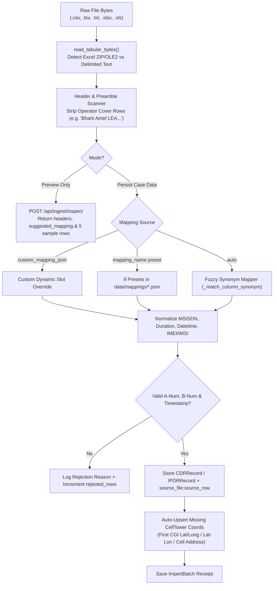

# Data Ingestion & Normalization Engine

## Module Overview

The **Ingestion Engine** (`app/ingest.py`) is engineered for real-world Indian telecom variability. Law Enforcement Agencies (LEAs) receive CDR and IPDR extracts from Bharti Airtel, Reliance Jio, Vodafone Idea, and BSNL in `.csv`, `.tsv`, `.txt`, `.xlsx`, and `.xls` files—often prefixed by multi-line LEA request headers, inconsistent MSISDN country prefixes, mixed date formats, and `mm:ss` duration strings.

Instead of rejecting imperfect files or requiring manual Excel cleanup, the engine performs **automatic header scanning, synonym inference, field normalization, row-level validation reporting, and automatic Cell Tower coordinate extraction**.

---

## Multi-Format Ingestion Workflow

---

## Supported File Formats & Header Inspection (`read_tabular_bytes` & `inspect_uploaded_file`)

1. **Spreadsheet Support (`.xlsx`, `.xls`):**
   - Parsed natively via `pandas.read_excel` (`openpyxl` engine for OOXML, auto-fallback for legacy `.xls`).
2. **Delimited Text Support (`.csv`, `.tsv`, `.txt`):**
   - Encodings attempted in order: `utf-8-sig`, `utf-8`, `latin-1`.
   - Delimiter inference tests `,`, `\t`, `;`, and `|` on LEA cover-sheet lines to pinpoint the true header row containing canonical keywords (`calling`, `caller`, `a party`, `target`, `msisdn`, `subscriber`, `source ip`, `cell`, `call type`, `imei`).
   - All cover/metadata lines above the detected header row are stripped seamlessly (`preamble_rows_skipped`).
3. **Zero-Upload Column Preview (`POST /api/ingest/inspect`):**
   - Returns `filename`, `detected_format`, `columns`, `suggested_mapping` (mapped to canonical slots like `a_number`, `b_number`, `start_time`, `duration`, `cell_id`, `imei`, `imsi`, or IPDR slots `subscriber_number`, `source_ip`, `source_port`, `session_start`), `sample_rows`, and `total_preview_rows`.

---

## Normalization Primitives (`app/ingest.py`)

### 1. Phone Number Standardization (`normalize_phone_number`)
- Strips `+91`, `0091`, spaces, hyphens, and leading `0` from 10-digit Indian mobile numbers starting with `[6-9]`.
- Preserves foreign international dial strings (`+971...`, `+44...`) and statutory/short service numbers (`1930`, `112`, `139`, `56161`).

### 2. Flexible Duration Parser (`parse_duration_to_sec`)
- Converts both integer/float strings (`"765"`, `"182.0"`) and clock formats (`"MM:SS"` such as `"04:35"` -> `275`, or `"HH:MM:SS"` such as `"01:02:10"` -> `3730`).

### 3. Multi-Format Timestamp Normalizer (`parse_datetime_flexible`)
- Evaluates ISO strings, `DD/MM/YYYY HH:MM:SS`, `DD-MM-YYYY HH:MM:SS`, `YYYY/MM/DD HH:MM:SS`, separate `Call Date` + `Call Time` concatenation, and AM/PM formats—emitting unified ISO-8601 strings (`YYYY-MM-DDTHH:MM:SS`).

---

## Preset Mappings (`data/mappings/`)

| Preset ID | Carrier / Schema Format | Type | Notable Field Handling |
| :--- | :--- | :--- | :--- |
| `airtel_lea` | Bharti Airtel LEA Standard CDR | CDR | `Calling Party Telephone Number`, `First CGI`, `Last CGI`, `Dur(s)` |
| `jio_lea` | Reliance Jio LEA Standard CDR | CDR | VoLTE indicators, `A Party`, `B Party`, `First Cell ID` |
| `operator_a` | Operator A - DoT 22-Field Standard CDR | CDR | Standard 22-field CMS/DoT schema |
| `operator_b` | Operator B - Telco MSC Switch 22-Field CDR | CDR | `mm:ss` duration format parsing |
| `sandhan_operator` | Sandhan Police Format - Standard CDR | CDR | `MOC`/`MTC` direction normalization |
| `vega_operator` | Vega-4n6 Forensic CDR Schema | CDR | Direction flags & lat/lon columns |
| `ipdr_operator_a` | Operator A - DoT Carrier NAT 22-Field IPDR | IPDR | Public/Translated IP, Port, Protocol, App Hint |
| `jio_cgnat_ipdr` | Reliance Jio CGNAT IPDR Format | IPDR | Translated Public IP + Ports + Uplink/Downlink bytes |
| `sandhan_ipdr` | Sandhan Police Format - IPDR Session Log | IPDR | Session timestamps & subscriber MSISDN |

---

## Automatic Cell Tower Co-Discovery & Multi-Source Seeding

Even when uploaded carrier CSVs contain towers absent from static master lookup tables, `ingest_cdr_data` automatically extracts coordinates inline and upserts `CellTower` rows:
- Parses combined slash/comma coordinate columns (`First CGI Lat/Long` such as `26.903/75.742`, `Last CGI Lat/Long`, `Lat/Long`) or separate `Lat`/`Latitude`/`First Lat` & `Lon`/`Longitude`/`First Lon` columns.
- Captures `Tower Address` / `Cell Address` / `Area` / `Location` alongside CGI LAC segments (`MCC-MNC-LAC-CELLID`).
- **Startup Master Seeding (`seed_towers_from_csv`):** Pre-loads towers at boot in priority order from `data/rajasthan_cell_towers_master.csv`, `data/towers.csv`, and `data/sample_police_data/sample_cell_towers.csv`.

---

## Comprehensive Police Sample Formats (`sample_data/`)

Generated by `scripts/generate_police_samples.py`:
- **`sample_cdr_comprehensive.csv` (1,500 rows, 23 columns):** Includes `Target No`, `Calling Party Telephone Number`, `Called Party Telephone Number`, `Call Type`, `Call Date`, `Call Time`, `Call Date Time`, `Call Duration`, `Dur(s)`, `First Cell ID`, `First CGI`, `First CGI Lat/Long`, `Last Cell ID`, `Last CGI`, `Last CGI Lat/Long`, `Tower Address`, `IMEI`, `IMSI`, `Call Forwarding No`, `SMS Center Number`, `Roaming Circle`, `Service Provider`, `Disconnect Cause`.
- **`sample_ipdr_comprehensive.csv` (1,000 rows, 24 columns):** Includes `Subscriber MSISDN`, `Source IP`, `Source Port`, `Translated IP`, `Translated Port`, `Destination IP`, `Destination Port`, `Protocol`, `Session Start Time`, `Session End Time`, `Session Duration`, `Data Volume Up Link`, `Data Volume Down Link`, `Total Bytes Transferred`, `Access Point Name`, `App Protocol Hint`, `Application`, `IMEI`, `IMSI`, `First Cell ID`, `Last Cell ID`, `Tower Address`, `Roaming Circle`, `PGW IP Address`.
