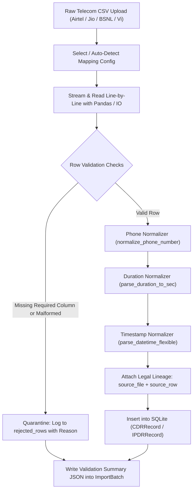

# Ingestion Engine & Data Normalization

## Module Overview

The **Ingestion Engine** (`app/ingest.py`) processes raw telecom data feeds provided by Indian Telecom Service Providers (Airtel, Jio, Vi, BSNL). In real investigations, each telecom operator outputs CDR and IPDR data using completely different column naming conventions, date formats, and call duration representations.

This module provides a unified data mediation pipeline with:
1. **Dynamic JSON Column Mapping** for plug-and-play operator schemas.
2. **Robust Data Normalization** for phone numbers, call durations, and multi-format timestamps.
3. **Data Quality Quarantine & Validation Logging** with per-row rejection reasons.
4. **Forensic Lineage Tagging** stamping `source_file` and `source_row` for Section 65B compliance.

---

## Architectural Flow



---

## Dynamic Column Mappings

Instead of hardcoded parsers, column associations are stored as configurable JSON definitions in `data/mappings/`. Investigators can inspect, add, or alter mappings at runtime via `/api/mappings`.

### Operator A Example (`data/mappings/operator_a.json`)
```json
{
  "name": "Operator A Standard CDR",
  "file_type": "CDR",
  "columns": {
    "calling_number": "A_PARTY",
    "called_number": "B_PARTY",
    "timestamp": "CALL_TIME",
    "duration": "DURATION_SEC",
    "call_type": "CALL_TYPE",
    "imei": "IMEI_NUMBER",
    "imsi": "IMSI_NUMBER",
    "cell_id": "FIRST_CELL_ID"
  },
  "duration_format": "seconds",
  "datetime_format": "%Y-%m-%d %H:%M:%S"
}
```

### Operator B Example (`data/mappings/operator_b.json`)
Handles localized prefix variants and minute-second strings (`mm:ss`):
```json
{
  "name": "Operator B Legacy CDR",
  "file_type": "CDR",
  "columns": {
    "calling_number": "SOURCE_CALLER",
    "called_number": "DEST_TARGET",
    "timestamp": "DATE_TIME_REC",
    "duration": "CALL_LEN_MIN_SEC",
    "call_type": "EVENT_DESC",
    "imei": "DEVICE_IMEI",
    "imsi": "CARD_IMSI",
    "cell_id": "CGI_CODE"
  },
  "duration_format": "mm:ss",
  "datetime_format": "%d/%m/%Y %I:%M %p"
}
```

---

## Core Sanitization Algorithms

### 1. Indian Phone Number Normalization (`normalize_phone_number`)
Strips international dialing codes (`+91`, `91`), trunk dialing zero (`0`), and whitespace/dashes, returning a canonical 10-digit mobile number:
```python
def normalize_phone_number(raw_num: str | None) -> str:
    if not raw_num or pd.isna(raw_num):
        return ""
    s = re.sub(r"[^\d+]", "", str(raw_num).strip())
    if s.startswith("+91") and len(s) == 13:
        s = s[3:]
    elif s.startswith("91") and len(s) == 12:
        s = s[2:]
    elif s.startswith("0") and len(s) == 11:
        s = s[1:]
    return s
```

### 2. Flexible Duration Parser (`parse_duration_to_sec`)
Handles integer seconds, `mm:ss`, and `hh:mm:ss`:
- `45` $\rightarrow 45$ seconds
- `03:20` $\rightarrow 200$ seconds
- `01:15:30` $\rightarrow 4530$ seconds

### 3. Multi-Format Timestamp Parser (`parse_datetime_flexible`)
Iteratively matches against standard formats:
- `%Y-%m-%d %H:%M:%S`
- `%d/%m/%Y %H:%M:%S`
- `%d-%m-%Y %H:%M:%S`
- `%d/%m/%Y %I:%M %p` (12-hour AM/PM)
- `%Y-%m-%dT%H:%M:%S` (ISO8601)

All dates are stored in canonical ISO8601 format (`YYYY-MM-DDTHH:MM:SS`) to enable indexed range queries.

---

## Validation & Quarantine Handling

Every batch import produces an `ImportBatch` record containing:
- `total_rows`: Total physical lines in the uploaded file.
- `valid_rows`: Number of successfully parsed records stored in the database.
- `rejected_rows`: Number of discarded rows.
- `validation_summary_json`: Detailed array listing line number, error code, and rejected payload.

Common rejection categories:
- `MISSING_CALLER_OR_RECEIVER`: Empty primary phone numbers.
- `INVALID_IMEI`: IMEI failed length validation (expected 14-16 digits).
- `UNPARSEABLE_TIMESTAMP`: Non-standard date representation.
- `DUPLICATE_ROW`: Identical record previously processed.

---

## Module Cross-References

- Ingested records feed directly into **[Forensic Analytics](forensic_analytics.md)**.
- Cell IDs are linked against GIS locations in **[Geospatial Tracking](geospatial_tracking.md)**.
- IPDR records are processed by the **[IPDR NAT Resolver](ipdr_nat_resolver.md)**.
