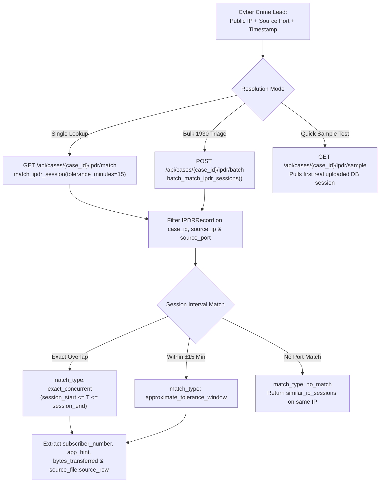

# IPDR & Carrier-Grade NAT (CGNAT) Resolver

## Module Overview

The **IPDR Resolution Engine** (`app/ipdr.py`) solves Carrier-Grade NAT (CGNAT) subscriber de-anonymization across both single forensic lookups and high-volume cyber complaint triaging.

Because Indian mobile telecom operators route thousands of subscribers simultaneously behind shared public IPv4 gateways using dynamic source-port translation, an IP address alone cannot identify a suspect in court. Investigators must correlate **Public IP + Source Port + Session Window Timestamp** against carrier IPDR logs to attribute activity to a specific subscriber (`subscriber_number`) with full Section 65B lineage.

---

## Single & Bulk CGNAT Resolution Workflow

---

## Core Engine Functions (`app/ipdr.py`)

### 1. Triple-Key NAT Match (`match_ipdr_session`)
Accepts `(case_id, ip, port, query_timestamp, db, tolerance_minutes=15)`:
- Normalizes ISO timestamps (`YYYY-MM-DDTHH:MM:SS` or space-separated variants).
- Queries `IPDRRecord` rows filtered by `case_id`, `source_ip`, and `source_port`.
- Classifies hits into:
  - `exact_concurrent`: Target timestamp falls strictly between `session_start` and `session_end`.
  - `approximate_tolerance_window`: Nearest edge is within `tolerance_minutes * 60` seconds (default ±15 minutes to handle NTP/bank clock skew).
  - Fallback diagnostic: On mismatch, queries up to 5 sessions sharing `source_ip` (`similar_ip_sessions`) to assist investigators when logs contain off-by-one ports.
- Returns `match_found`, `match_type`, `primary_subscriber`, `session`, `sessions`, and `confidence_note`.

### 2. Bulk CGNAT Triage (`batch_match_ipdr_sessions`)
Exposed via `POST /api/cases/{case_id}/ipdr/batch` for **1930 Cyber Helpline** complaints and bulk bank transaction logs:
- Accepts JSON `{ "queries": [{"ip": "...", "port": ..., "timestamp": "...", "query_id": "..."}], "tolerance_minutes": 15 }`.
- Evaluates each tuple sequentially, skips malformed inputs cleanly (`invalid_input`), and returns aggregated counts (`total_queries`, `matched_count`, `unmatched_count`, `identified_subscribers_count`, `identified_subscribers`) alongside per-query results.

### 3. Subscriber Session Profiler (`get_subscriber_ipdr_summary`)
Exposed via `GET /api/cases/{case_id}/ipdr/subscriber?subscriber=...`:
- Matches both 10-digit MSISDNs and `+91` prefixed subscriber records.
- Summarizes `total_sessions`, `total_bytes_transferred`, `app_breakdown` histogram (`App Protocol Hint` / unclassified traffic), and up to 50 chronological session records with `source_file:source_row` citations.

### 4. Dynamic Quick-Test Helper (`GET /api/cases/{case_id}/ipdr/sample`)
Eliminates hardcoded demo IP placeholders in the UI by querying the first uploaded `IPDRRecord` in the active case (`source_ip`, `source_port`, `session_start`, `subscriber`) for one-click verification testing.

---

## Supported 24-Field DoT / CGNAT IPDR Schema (`sample_data/sample_ipdr_comprehensive.csv`)

The comprehensive IPDR schema captures:
`Subscriber MSISDN`, `Source IP`, `Source Port`, `Translated IP`, `Translated Port`, `Destination IP`, `Destination Port`, `Protocol`, `Session Start Time`, `Session End Time`, `Session Duration`, `Data Volume Up Link`, `Data Volume Down Link`, `Total Bytes Transferred`, `Access Point Name`, `App Protocol Hint`, `Application`, `IMEI`, `IMSI`, `First Cell ID`, `Last Cell ID`, `Tower Address`, `Roaming Circle`, and `PGW IP Address`.
