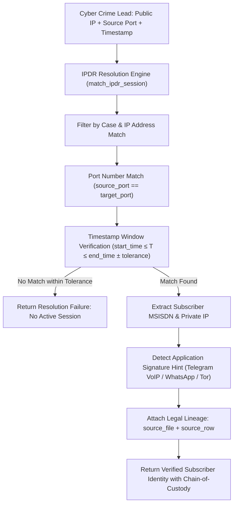

# IPDR & Carrier-Grade NAT (CGNAT) Resolver

## Module Overview

The **IPDR Resolution Engine** (`app/ipdr.py`) resolves one of the toughest challenges in modern cyber crime investigation: **Carrier-Grade NAT (CGNAT) Subscriber De-anonymization**.

Because IPv4 addresses are scarce, Indian telecom operators route thousands of mobile subscribers simultaneously through a single public IP address using dynamic port translation. A public IP alone is useless in court—investigators must resolve the combination of **Public IP + Public Port + Exact Timestamp** to pinpoint the true subscriber number (MSISDN).

---

## Architectural Resolution Workflow



---

## The CGNAT Dilemma & Solution

### The Challenge
When a cyber criminal executes an unauthorized bank transfer, Telegram extortion call, or dark-web forum post, the victim's web server logs only:
$$\text{Public IP: } 103.211.54.12, \quad \text{Port: } 44321, \quad \text{Timestamp: } 2026-11-20\ 18:25:10$$
Querying the ISP with only the IP `103.211.54.12` returns hundreds of potential users.

### The Resolution Algorithm
The `match_ipdr_session` engine executes a triple-key lookup with time-drift compensation:

```python
def match_ipdr_session(
    case_id: str,
    ip: str,
    port: int,
    timestamp_str: str,
    db: Session,
    tolerance_seconds: int = 300
):
    target_dt = parse_iso_or_standard_datetime(timestamp_str)
    
    # Query candidate IPDR sessions on matching IP & Port
    candidates = db.query(IPDRRecord).filter(
        IPDRRecord.case_id == case_id,
        or_(
            and_(IPDRRecord.source_ip == ip, IPDRRecord.source_port == port),
            and_(IPDRRecord.destination_ip == ip, IPDRRecord.destination_port == port)
        )
    ).all()

    for rec in candidates:
        start = parse_iso_or_standard_datetime(rec.session_start)
        end = parse_iso_or_standard_datetime(rec.session_end)
        
        # Verify if target timestamp falls within session window (with tolerance)
        if (start - timedelta(seconds=tolerance_seconds)) <= target_dt <= (end + timedelta(seconds=tolerance_seconds)):
            return {
                "matched": True,
                "subscriber_number": rec.subscriber_number,
                "private_ip": rec.source_ip,
                "session_start": rec.session_start,
                "session_end": rec.session_end,
                "bytes_transferred": rec.bytes_transferred,
                "app_hint": rec.app_hint,
                "evidence": f"{rec.source_file}:Row {rec.source_row}"
            }
```

---

## Application Protocol Fingerprinting

The engine inspects packet sizes, port allocations, and destination endpoint patterns to identify application signatures:

| Protocol / App Signature | Port / Pattern | Forensic Significance |
| :--- | :--- | :--- |
| **Telegram (Encrypted VoIP)** | Dynamic UDP / Port range with packet size heuristics | Voice calls between syndicate conspirators |
| **WhatsApp Media / Call** | Standard STUN/TURN & media IP ranges | File transfer or encrypted chat sessions |
| **Signal Messenger** | TLS port 443 over dedicated Signal endpoints | Secure operational comms |
| **Tor / Onion Proxy** | Known directory server IPs & uniform cell sizes | Anonymized network browsing |
| **Banking / Payment Gateway** | HTTPS 443 to certified financial domains | Fraudulent fund transfers |

---

## Subscriber IPDR Profiling (`get_subscriber_ipdr_summary`)

In addition to point lookups, the engine can summarize all Internet sessions for a target suspect:
- Cumulative data volume (Megabytes / Gigabytes transferred).
- Peak session hours (day vs. night data usage).
- Breakdown of accessed applications and destinations.
- Identification of secondary VoIP calling apps used to bypass standard cellular CDR logging.

---

## Module Cross-References

- IPDR matches link to CDR call profiles in **[Forensic Analytics](forensic_analytics.md)**.
- Natural language IPDR queries are handled by **[AI Investigation Assistant](ai_assistant.md)**.
