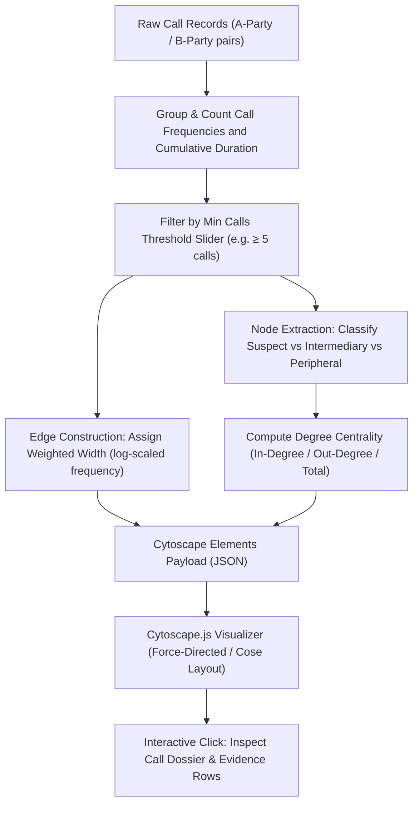

# Network Topology & Graph Engine

## Module Overview

The **Network Topology Engine** (`app/analysis.py`, `app/static/app.js`) transforms tabular call records into interactive link graphs using **Cytoscape.js**. 

By calculating node degree centrality, edge call-volume weights, and intersection clustering, the engine allows investigators to untangle sprawling communication webs and expose criminal syndicate hierarchies.

---

## Graph Pipeline Architecture



---

## Graph Modeling & Serialization

The endpoint `/api/cases/{case_id}/network` yields a Cytoscape-compliant structure:

### Node Data Schema
```json
{
  "data": {
    "id": "9829011111",
    "label": "9829011111\n(Central Kingpin)",
    "is_suspect": true,
    "degree": 14,
    "total_calls": 128,
    "node_type": "kingpin"
  }
}
```

### Edge Data Schema
```json
{
  "data": {
    "id": "9829022222-9829011111",
    "source": "9829022222",
    "target": "9829011111",
    "call_count": 42,
    "duration_sec": 3840,
    "weight": 6.5
  }
}
```

---

## Key Visual & Algorithmic Features

### 1. Dynamic Threshold Filtering (`min_calls`)
Spam calls, missed calls, and peripheral contacts often clutter telecom graphs. The dynamic threshold slider filters out edges below a configurable call count:
$$\text{Filter Condition: } \text{call\_count} \geq \theta_{\text{min}}$$
Setting $\theta = 5$ eliminates 85% of background noise, instantly isolating high-frequency communication trunks between co-conspirators.

### 2. Node Typology & Color Coding
- 🔴 **Crimson Red Nodes**: Designated prime suspects ($S_1, S_2, S_3$).
- 🔵 **Cobalt Blue Nodes**: Common intermediary numbers contacted by multiple targets.
- 🟡 **Gold / Amber Nodes**: High-degree central nodes (likely handlers/kingpins).
- ⚪ **Slate Gray Nodes**: Standard peripheral contacts.

### 3. Edge Weighting
Edge thickness in the canvas is dynamically scaled using logarithmic weighting:
$$\text{Width} = 1 + \log_{2}(1 + \text{call\_count})$$
This ensures thick, prominent lines for heavy communication trunks without obscuring smaller secondary links.

### 4. Interactive Node Inspector
Clicking any node or edge in the Cytoscape canvas launches the **Forensic Inspector Modal**, displaying:
- Total calls, talk time, and direction breakdown.
- First contact date and last contact date.
- Associated IMEI devices and active cell towers.
- Direct link to Section 65B raw evidence rows.

---

## Module Cross-References

- Network clusters feed into **[Forensic Analytics](forensic_analytics.md)** for common numbers analysis.
- Graph queries can be invoked conversantly via **[AI Investigation Assistant](ai_assistant.md)**.
