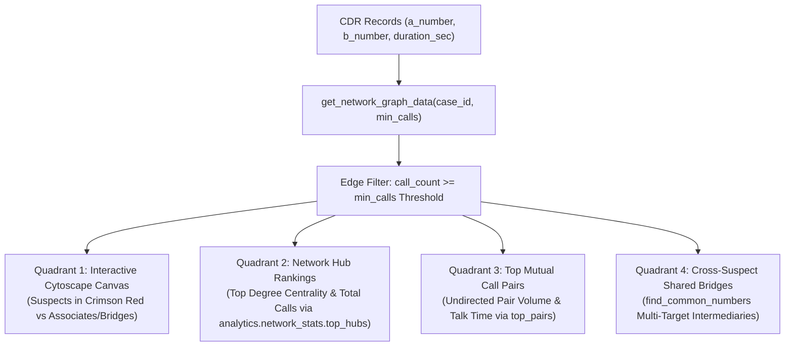

# Network Topology & 4-Quadrant Graph Engine

## Module Overview

The **Network Topology Engine** (`app/analysis.py`, `app/static/app.js`) converts tabular call/SMS records into an interactive **Cytoscape.js** network topology paired with a **4-Quadrant Analytical View (`graph`)**. By combining force-directed node layouts, degree centrality metrics, mutual pair ranking, and cross-suspect bridge isolation, investigators can unravel extortion syndicates, cyber-fraud call centers, and money-mule hierarchies.

---

## 4-Quadrant Graph Architecture (`graph` Module)

---

## API & Cytoscape Graph Serialization

### 1. Network Payload (`GET /api/cases/{case_id}/network?min_calls=1`)
Executed by `get_network_graph_data(case_id, db, min_calls)`:
- **Suspect Identification:** Dynamically extracts primary targets via `get_suspect_numbers_for_case(case_id, db)` (from case `brief_data` or top active callers when uploaded ad-hoc without a brief).
- **Nodes (`nodes`):** Each node carries `id`, `label`, `is_suspect` (boolean), `call_count`, and `degree` (unique neighbor count). Suspect nodes render in high-visibility crimson red (`#dc2626` / accent borders); common bridges and peripheral numbers follow topological sizing.
- **Edges (`edges`):** Aggregated undirected A-B communication trunks carrying `source`, `target`, `call_count`, `duration_sec`, and visual line weight.
- **Live Threshold Filtering (`min_calls`):** Increasing the threshold slider filters incidental wrong-number/OTP traffic so kingpins and multi-suspect conduits stand out cleanly.

### 2. Bilateral Link Forensics (`GET /api/cases/{case_id}/link-analysis?num1=...&num2=...`)
Executed by `analyze_link_between_numbers(case_id, num1, num2, db)`:
- Quantifies direct bilateral calls (`num1 ↔ num2`), total talk-time seconds, first/last contact timestamps, mutual indirect contacts shared by both numbers, shared BTS towers where both numbers latched, and chronological shared call evidence rows.

### 3. Case Analytics Topology Feeds (`GET /api/cases/{case_id}/analytics`)
Pre-computes `network_stats` (`top_hubs` sorted by unique contact degree and call volume, plus `top_pairs` sorted by bidirectional call frequency) alongside `common_contacts` matrix correlation for immediate UI rendering in `graph`, `network-analysis`, and `link-analysis` views.

---

## Cross-References

- Node targets feed directly into the **Suspect Investigation Workspace** (`GET /api/cases/{case_id}/suspect/{phone}/summary`).
- Physical BTS co-locations between linked nodes appear in **[Geospatial Tracking](geospatial_tracking.md)**.
