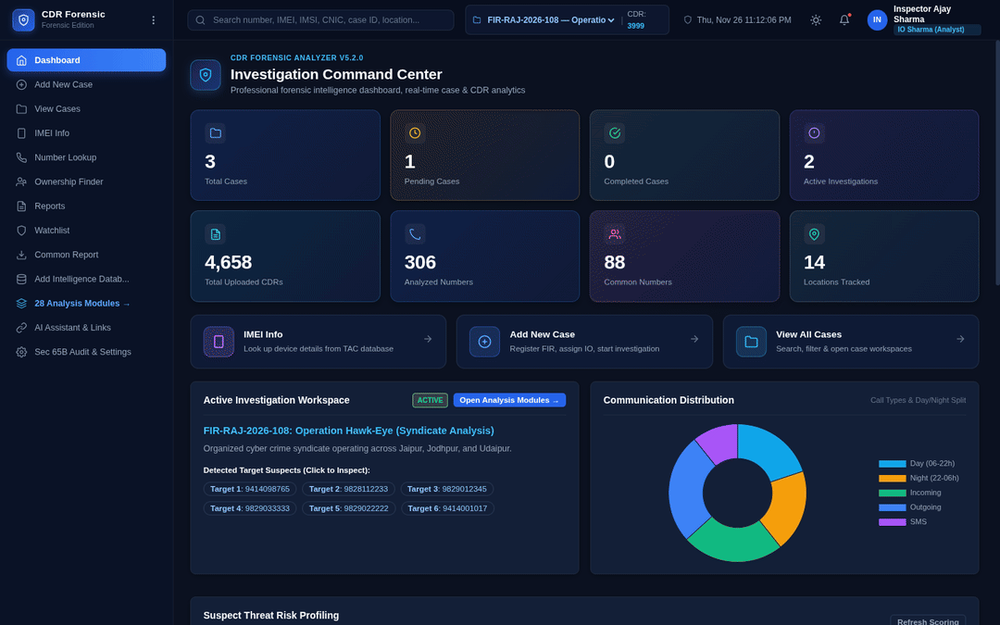
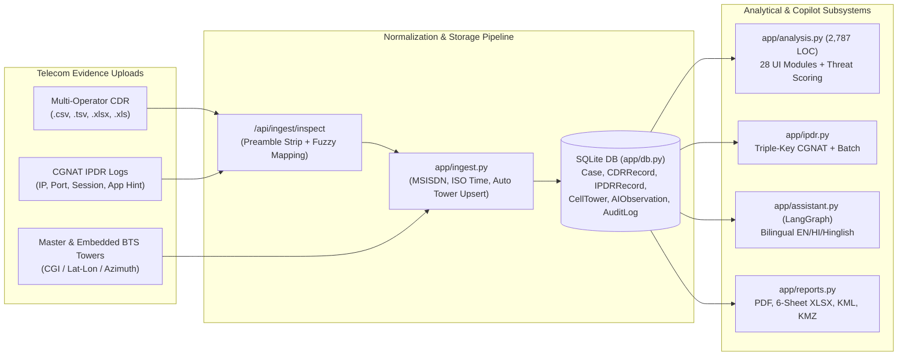
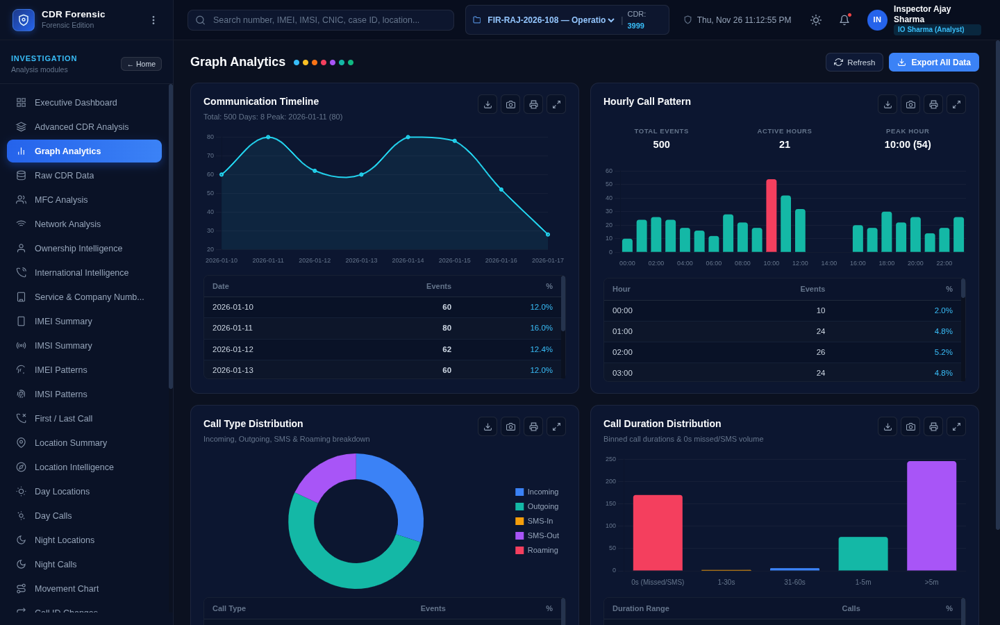
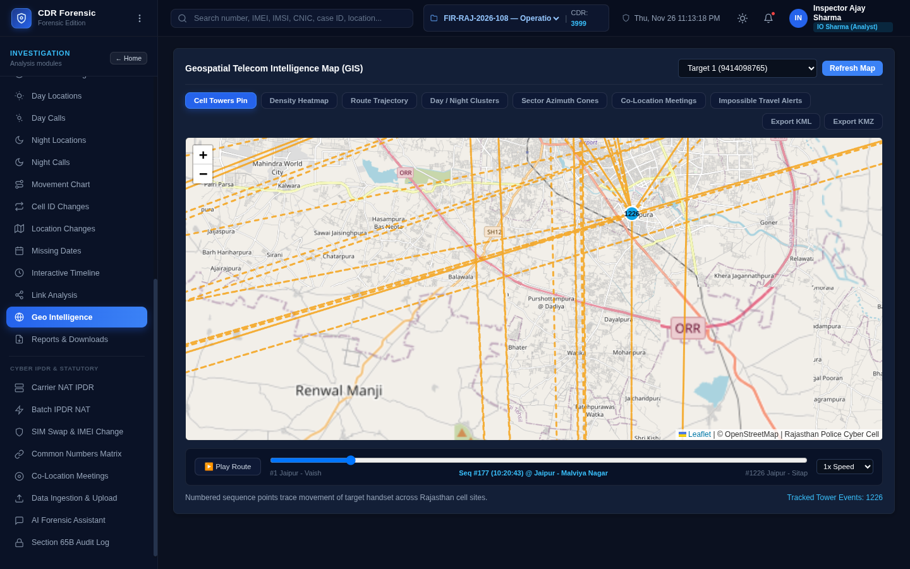
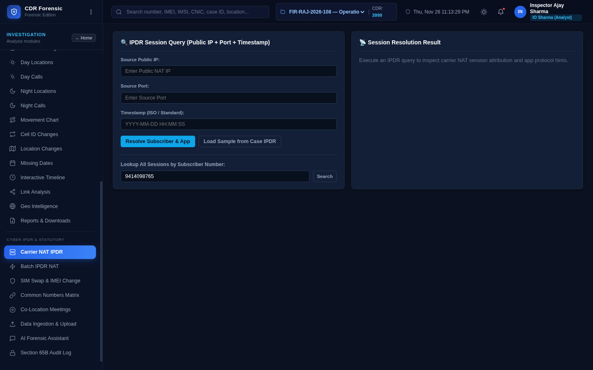

# System Architecture & Repository Overview

## Executive Summary

The **Rajasthan Police Cyber Forensic Command Center** (`Rajistanhackathon` / Problem Statement PS03) is a **dynamic, zero-dummy telecommunications forensics platform** purpose-built for Law Enforcement Agencies (LEAs), Cyber Police Stations, and Special Task Forces.

It solves the real-world investigative bottleneck of correlating disparate carrier formats (Bharti Airtel, Reliance Jio, Vodafone Idea, BSNL, DoT LEA exports) across **Call Detail Records (CDR)**, **Carrier-Grade NAT IP Detail Records (IPDR)**, **Base Transceiver Station (BTS) Cell Towers**, and **IMEI/IMSI hardware identities**, while maintaining strict **Section 65B(4) Indian Evidence Act / Section 63 Bharatiya Sakshya Adhiniyam (BSA) 2023** chain-of-custody guarantees.

---

## Core Architecture & Dynamic Execution Flow

All metrics, graphs, suspect workspaces, and GIS overlays compute dynamically from uploaded case evidence—never from hardcoded fixtures.

---

## Visual Command Modules

| 🎖️ Executive Command Center | 🕸️ 4-Quadrant Syndicate Graph |
| :---: | :---: |
|  |  |
| **🛰️ 7-Mode Tactical Police GIS** | **🌐 Carrier NAT IPDR De-Anonymizer** |
|  |  |

---

## Dual-Sidebar Command UI & 28 Investigation Modules

The Single-Page Application (`app/static/index.html`, `app/static/app.js`, `app/static/style.css`) implements a Dual-Sidebar architecture using monochrome vector iconography:

1. **Home Command Center Sidebar (`#sidebar-home-menu`):**
   - **Dashboard Overview** (`dashboard` — 8 Executive KPI cards, Case Registry, Activity & Threat Matrices)
   - **Cases / FIR Registration** (Modal capturing Case ID, Title, Description, `case_type`, `police_station`, `investigator_name`, and `status`)
   - **Import CSV / Excel** (`import` — Interactive header preview + mapping override)
   - **Global Search / Lookup** (`GET /api/lookup`, `GET /api/cases/{case_id}/search`)
   - **IPDR CGNAT & Bulk 1930 Batch** (`ipdr`, `batch-ipdr`)
   - **AI Copilot & SP Verification** (`assistant`)
   - **Audit Chain & Integrity Inspector** (`audit`)
2. **28 Investigation Modules Sidebar (`#sidebar-investigation-menu`):**
   - **Overview & Core:** `dashboard`, `advanced-cdr` (Suspect Investigation Workspace with 10 KPI cards, real ownership resolution, and operator distribution), `graph` (4-Quadrant Network Analytics), `raw-cdr` (paginated ledger + client CSV export).
   - **Subscriber & Device Intelligence:** `mfc`, `network-analysis`, `ownership`, `international`, `service-numbers`, `imei-summary`, `imsi-summary`, `imei-patterns`, `imsi-patterns`.
   - **Temporal & Mobility Forensics:** `first-last`, `location-summary`, `location-intelligence`, `day-locations`, `day-calls`, `night-locations`, `night-calls`, `movement`, `cell-id-changes`, `location-changes`, `missing-dates`, `interactive-timeline`.
   - **Spatial & Exports:** `link-analysis`, `geo-map` (**7 Tactical GIS Map Modes** + chronological playback scrubber), `reports` (PDF, XLSX, KML, KMZ).

---

## Relational Database Schema (`app/db.py`)

| ORM Model | Table | Primary Purpose & Lineage Columns |
| :--- | :--- | :--- |
| `User` | `users` | RBAC officer credentials (`username`, `password_hash`, `role`, `full_name`, `badge_number`) |
| `Case` | `cases` | FIR metadata & JSON suspect roster (`id`, `title`, `description`, `status`, `created_by`, `brief_data`) |
| `ImportBatch` | `import_batches` | Ingestion receipt (`filename`, `file_type`, `mapping_name`, `total_rows`, `valid_rows`, `rejected_rows`, `warnings_json`) |
| `CDRRecord` | `cdr_records` | Normalized telephony/SMS event (`a_number`, `b_number`, `call_type`, `start_time`, `duration_sec`, `imei`, `imsi`, `cell_id`, `source_file`, `source_row`, `raw_data_json`) |
| `IPDRRecord` | `ipdr_records` | CGNAT session (`subscriber_number`, `source_ip`, `source_port`, `destination_ip`, `destination_port`, `session_start`, `session_end`, `bytes_transferred`, `app_hint`, `source_file`, `source_row`) |
| `CellTower` | `cell_towers` | Geo-located BTS coordinates (`cell_id`, `lac`, `lat`, `lon`, `area_name`, `azimuth`, `operator`) |
| `AIObservation` | `ai_observations` | Persisted Copilot outputs (`query_text`, `intent`, `answer_text`, `evidence_json`, `status`, `verified_by`, `verified_at`) |
| `AuditLog` | `audit_logs` | Tamper-evident SHA-256 ledger (`username`, `role`, `action`, `details`, `ip_address`, `prev_hash`, `entry_hash`) |

---

## Comprehensive Sample Generator & Engineering Reports

- **Sample Generator:** `scripts/generate_police_samples.py` builds 1,500 comprehensive CDR rows (23 LEA columns), 1,000 CGNAT IPDR rows (24 DoT columns), and 14 geo-tagged Rajasthan BTS towers across `sample_data/` and `data/sample_police_data/`.
- **Upgrade & UI Audit Documentation:** See [`FORENSIC_MODULES_UPGRADE_REPORT.md`](FORENSIC_MODULES_UPGRADE_REPORT.md) and [`../report.md`](../report.md) for the complete architecture revamp specification.
