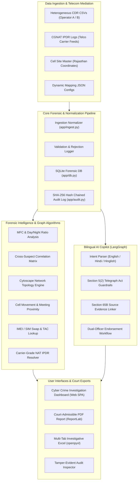
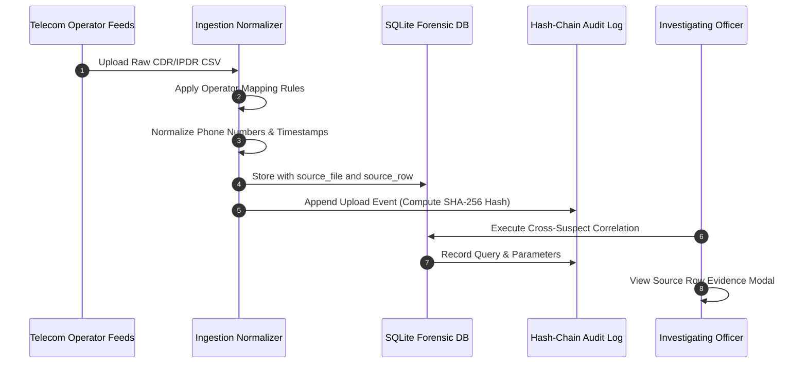

# Rajasthan Police CDR/IPDR Analysis Tool & AI Investigation Assistant (PS03)

## System Overview & Architecture

The **Rajasthan Police CDR/IPDR Analysis Tool** is a field-ready forensic intelligence platform tailored for cyber crime investigators and senior supervisory police officers. Built for the **Rajasthan Police Hackathon 2026 (Problem Statement PS03)**, the system solves the operational bottleneck of processing high-volume, heterogeneous Call Detail Records (CDR) and Carrier-Grade NAT (CGNAT) Internet Protocol Detail Records (IPDR).

Equipped with an autonomous **AI Investigation Copilot**, the platform automates complex forensic queries, uncovers hidden crime syndicate links, detects physical co-location meetings, tracks IMEI/SIM swapping anomalies, and resolves CGNAT sessions down to specific subscribers and mobile applications.

---

### High-Level System Architecture

---

## Core Operational Modules

The codebase is organized into modular services supporting the entire investigation lifecycle:

| Module | Primary Implementation | Functional Scope |
| :--- | :--- | :--- |
| **[Ingestion Engine](ingestion_engine.md)** | `app/ingest.py` | Normalizes heterogeneous telco formats (+91 stripping, date/time parsing, duration seconds conversion), validates data integrity, and stamps chain-of-custody lineage. |
| **[Forensic Analytics](forensic_analytics.md)** | `app/analysis.py` | 2,000+ lines of forensic routines: Most Frequent Callers (MFC), nocturnal ratio profiling, IMEI/SIM change tracking, TAC handset database, and dormancy analysis. |
| **[Geospatial Tracking](geospatial_tracking.md)** | `app/analysis.py`, `app/db.py` | Rajasthan cell site dump integration, chronological suspect movement trajectories, azimuth sectors, and spatial-temporal meeting detection algorithms. |
| **[Network Topology](network_topology.md)** | `app/analysis.py`, `app/static/app.js` | Generates Cytoscape.js network graphs with node degrees, edge weighting by call frequency, and filter thresholds to isolate syndicate kingpins. |
| **[IPDR NAT Resolver](ipdr_nat_resolver.md)** | `app/ipdr.py` | Resolves public IP + port + timestamp queries across Carrier-Grade NAT (CGNAT) logs to identify subscribers, ISP sources, and encrypted VoIP signatures. |
| **[AI Investigation Assistant](ai_assistant.md)** | `app/assistant.py` | LangGraph-powered bilingual AI assistant answering queries in English and Hindi/Hinglish, enforcing metadata-only legal guardrails, and citing Section 65B evidence rows. |
| **[Security & Audit Chain](security_audit_chain.md)** | `app/auth.py`, `app/audit.py` | Multi-tier RBAC (`investigating_officer`, `senior_officer`, `admin`) and SHA-256 hash-chained audit logging ensuring judicial tamper resistance. |
| **[Reporting Engine](reporting_engine.md)** | `app/reports.py` | Compiles formal judicial PDF reports with Section 65B Evidence Act certificates and structured multi-sheet Excel workbooks. |
| **[API Reference](api_reference.md)** | `app/main.py` | Full REST API documentation comprising 35+ endpoints covering all analysis, ingestion, authentication, and reporting routes. |

---

## Data Pipeline & Chain of Custody

Maintaining forensic integrity is essential for court admissibility under Indian legal statutes. Every single row ingested through the platform preserves its immutable provenance.

---

## Legal & Statutory Compliance Framework

### 1. Section 65B, Indian Evidence Act (Certificate of Electronic Records)
- Real-world criminal prosecutions require proof that electronic records have not been altered.
- The platform automatically stamps every extracted datum with `source_file` and `source_row`.
- Generated observations and PDF reports include statutory disclaimer footers and audit verification certificates signed by supervisory officers.

### 2. Section 5(2), Indian Telegraph Act (Wiretapping vs. Metadata Separation)
- The platform enforces an impenetrable AI guardrail: **Voice recordings, message contents, and call audio are categorically rejected.**
- When queried about call contents (e.g., *"Call me kya baat hui recording sunao"*), the AI assistant politely clarifies that CDR/IPDR data contains transmission metadata only, completely disallowing speculative or illegal wiretap queries.

---

## Interactive CodeWiki Navigation

Explore the dedicated module pages for in-depth algorithmic documentation, code signatures, and architecture diagrams:

- 📥 **[Ingestion Engine](ingestion_engine.md)** — Dynamic mapping configs, sanitization & validation
- 🔍 **[Forensic Analytics](forensic_analytics.md)** — MFC, cross-suspect correlation, IMEI swaps & TAC lookup
- 📍 **[Geospatial Tracking](geospatial_tracking.md)** — Trajectory timeline & meeting detection algorithm
- 🕸️ **[Network Topology](network_topology.md)** — Cytoscape graph modeling & syndicate isolation
- 🌐 **[IPDR NAT Resolver](ipdr_nat_resolver.md)** — CGNAT matching & app signature fingerprinting
- 🤖 **[AI Investigation Assistant](ai_assistant.md)** — LangGraph engine, bilingual NLP & Section 5(2) guardrails
- 🛡️ **[Security & Audit Chain](security_audit_chain.md)** — RBAC roles & tamper-evident hash chaining
- 📑 **[Reporting Engine](reporting_engine.md)** — Formal judicial PDF & multi-sheet Excel generation
- 🔌 **[API Reference](api_reference.md)** — Complete 35+ REST endpoints specification
