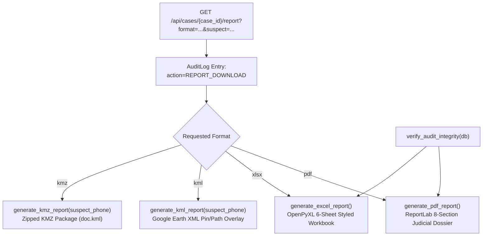

# Statutory & Geospatial Reporting Engine

## Module Overview

The **Reporting Engine** (`app/reports.py`) converts dynamic analytical findings, CGNAT IPDR logs, verified AI observations, and cell-tower mobility trails into four download formats via `GET /api/cases/{case_id}/report?format={pdf|xlsx|kml|kmz}`—plus client-side CSV export directly from the Raw CDR explorer (`app/static/app.js`).

Every exported PDF and Excel dossier embeds **chain-of-custody source citations** and a real-time **SHA-256 Audit Integrity Verification** block compliant with **Section 65B(4) Indian Evidence Act, 1872 / Section 63 BSA 2023**.

---

## Multi-Format Export Pipeline

---

## 1. Court-Admissible PDF Dossier (`generate_pdf_report`)

Formatted with official Rajasthan Police headers and a persistent bottom disclaimer footer (`"Draft for officer review - not a final conclusion | Synthetic Hackathon Demo Data Only"`):

1. **Case Overview Header:** Case ID, Title, Date Generated (IST), Investigating Unit (`State Cyber PS, Jaipur`), total CDR & IPDR record counts.
2. **Section 1 — Data Import & Ingestion Validation Summary:** Uploaded filenames, types (`CDR`/`IPDR`), applied mappings, total/valid/rejected row counts (`ImportBatch`).
3. **Section 2 — Suspect Threat Risk Profiling & Archetype Classifier:** Scores (`0–100`), risk tiers (`LOW`/`MEDIUM`/`HIGH`/`CRITICAL`), behavioral archetypes, and top risk factors via `calculate_suspect_threat_scores`.
4. **Section 3 — Cross-Suspect Common Number Correlation:** Shared intermediary contacts (`find_common_numbers`) with sample `source_file (Row N)` citations.
5. **Section 4 — IMEI / SIM Swap Anomaly Detection:** Handsets shared across multiple MSISDNs (`detect_imei_sim_changes`) with active date spans.
6. **Section 5 — Physical Co-Location / Meeting Detection:** Overlapping cell-tower events (`detect_meetings`), delta seconds, and dual evidence row citations.
7. **Section 6 — Carrier NAT (CGNAT) IPDR Traffic & Cyber Analysis:** Sampled subscriber sessions showing `Public NAT IP:Port`, `Destination IP:Port`, `Session Start`, and `App / Protocol Hint`.
8. **Section 7 — AI Assistant Observations & Officer Verification Status:** Queries, summarized findings, status (`PENDING VERIFICATION` / `VERIFIED` / `REJECTED`), and certifying officer ID.
9. **Section 8 — Section 65B(4) / Section 63 BSA 2023 Cryptographic Certificate:** Live execution of `verify_audit_integrity(db)` reporting `AUTHENTIC` vs `INTEGRITY_BREACH_DETECTED`, verified record counts, **Latest Merkle-Root SHA-256 Hash**, and **Genesis Hash**.

---

## 2. Six-Sheet Forensic Excel Workbook (`generate_excel_report`)

Styled with navy police headers (`#1E3A8A`) and auto-fitted column widths:

| Sheet Name | Contents & Record Cap |
| :--- | :--- |
| **`Case Summary`** | Case ID, Title, Status notice, UTC timestamp, CDR & IPDR row totals |
| **`CDR Normalized Data`** | Up to 1,000 normalized CDR rows (`A_Number`, `B_Number`, `Call_Type`, `Start_Time`, `Duration_Sec`, `IMEI`, `IMSI`, `Cell_ID`, `Source_File`, `Source_Row`) |
| **`IPDR Sessions`** | Up to 500 CGNAT session rows (`Subscriber`, `Source_IP`, `Source_Port`, `Dest_IP`, `Dest_Port`, `Session_Start`, `Session_End`, `Bytes`, `App_Hint`, Lineage) |
| **`AI Observations & Verification`** | Persisted AI queries, answers, confidence notes, verification status, verifying officer, timestamp |
| **`Threat Profiling`** | Suspect Threat Score, Risk Level, Archetype, Total Calls, Night Call %, IMEI Swaps, High-Speed Hops, International Calls, Factors |
| **`Section 65B Audit Trail`** | Integrity status, latest & genesis SHA-256 hashes, plus up to 500 chained `AuditLog` entries (`Previous_Hash`, `Entry_Hash`) |

---

## 3. Google Earth KML & KMZ Exports (`generate_kml_report`, `generate_kmz_report`)

Supports optional suspect filtering (`?suspect=9829012345`) for targeted courtroom or field briefing visualizations in Google Earth Pro / GIS tools:
- **Folder 1 — `Cell Towers`:** Distinct BTS placemarks resolved via `_resolve_tower` showing Cell ID, Area Name, and LAC.
- **Folder 2 — `Suspect Trajectory Route`:** Extruded `<LineString>` polyline linking chronological tower hops (`#routePath`).
- **Folder 3 — `Chronological Call Events`:** Up to 100 ordered event placemarks (`#callPoint`) detailing Caller, Callee, Duration, and BTS Area.
- **KMZ Packaging:** Compresses the generated XML cleanly into `doc.kml` inside a standard `.kmz` ZIP archive (`application/vnd.google-earth.kmz`).

---

## 4. Client-Side Raw CDR CSV Export

From the **Raw CDR (`raw-cdr`)** frontend module (`app/static/app.js`), investigators can export filtered call tables directly to `.csv` in-browser (`type: "text/csv"`) without re-querying the reporting pipeline.
