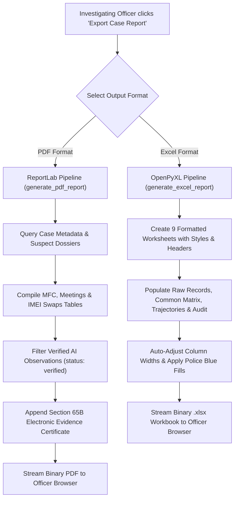

# Reporting Engine & Judicial Exports

## Module Overview

The **Reporting Engine** (`app/reports.py`) produces court-ready documentation for prosecution dockets, bail hearings, and supervisory reviews.

It exports:
1. **Formal Statutory PDF Report** (via `reportlab`) complete with department header, suspect dossiers, analytical findings, verified AI observations, and a Section 65B Evidence Act certificate.
2. **Multi-Tab Investigative Excel Workbook** (via `openpyxl`) containing filtered data sheets, analytical matrices, and complete audit logs for deeper spreadsheet modeling.

---

## Document Generation Workflow

---

## Formal PDF Report Architecture

### Key Report Sections
1. **Official Heading & Watermark**:
   - Rajasthan Police Hackathon 2026 header with case number, title, generation timestamp, and lead officer.
2. **Executive Case Brief**:
   - High-level synopsis of the syndicate operation (e.g., "Operation Maru-Drishti").
3. **Suspect Communication Profiles**:
   - Aggregated call volume, duration, and in/out ratio for each target.
4. **Most Frequent Callers (MFC)**:
   - Tabular ranking of top contacted parties with cumulative talk time.
5. **Cross-Suspect Shared Contacts**:
   - Common phone numbers linking two or more targets together.
6. **Physical Co-Location & Meeting Log**:
   - Tower IDs, physical addresses, meeting timestamps, and participants.
7. **Device & Identity Anomalies**:
   - Handset brand/model via TAC lookup and multi-SIM/IMEI swap events.
8. **Certified AI Observations**:
   - Observations endorsed by supervisory officers (`SP Verma`), including verification notes and timestamps.
9. **Section 65B Statutory Certificate**:
   - Printed declaration under the Indian Evidence Act affirming electronic data integrity and uninterrupted chain of custody.

---

## Multi-Tab Investigative Excel Workbook

The Excel exporter generates 9 distinct sheets:

| Sheet Name | Content & Forensic Utility |
| :--- | :--- |
| **Case Summary** | High-level case brief, date ranges, total records ingested, and involved officers. |
| **CDR Master** | Complete sanitized CDR records with caller, receiver, duration, timestamp, and cell ID. |
| **Top Contacts** | Ranked list of frequent callers with incoming/outgoing ratios. |
| **Common Numbers** | Cross-suspect communication matrix identifying syndicate brokers. |
| **Tower Timeline** | Chronological tower hops across Rajasthan coordinates. |
| **Meeting Log** | Spatiotemporal co-location incidents with participant phone numbers. |
| **IMEI SIM Swaps** | Multi-SIM per IMEI and multi-IMEI per SIM tracking table. |
| **IPDR Sessions** | Resolved CGNAT sessions, IP/port tuples, bytes transferred, and application hints. |
| **Audit Log** | Immutable forensic audit log showing access history and chain of custody. |

---

## Legal Disclaimer & Statutory Footer

All generated reports feature statutory footers:
> *"DRAFT FOR POLICE INVESTIGATION REVIEW ONLY — NOT A FINAL CHARGE SHEET. Electronic record certified under Section 65B, Indian Evidence Act. Contains telecom metadata only under Section 5(2), Indian Telegraph Act."*

---

## Module Cross-References

- Reads raw data from **[Ingestion Engine](ingestion_engine.md)**.
- Consolidates analytics from **[Forensic Analytics](forensic_analytics.md)** and **[Geospatial Tracking](geospatial_tracking.md)**.
- Pulls verified endorsements from **[AI Investigation Assistant](ai_assistant.md)**.
