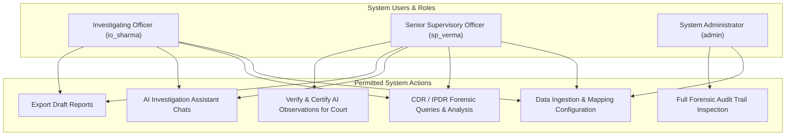

# Security, RBAC & Forensic Audit Chain

## Module Overview

The **Security & Audit Chain Engine** (`app/auth.py`, `app/audit.py`, `app/db.py`) enforces Role-Based Access Control (RBAC) and maintains an immutable audit trail for legal chain-of-custody verification.

In cyber crime and criminal forensics, courts demand tamper-evident proof of who accessed the data, when it was retrieved, what queries were executed, and who verified AI-derived observations.

---

## Multi-Tier Role-Based Access Control (RBAC)

The system enforces three distinct law enforcement user roles:



### Pre-Configured Demo Credentials

| Role | Username | Password | Badge Number | Operational Mandate |
| :--- | :--- | :--- | :--- | :--- |
| **Investigating Officer** | `io_sharma` | `IO@RajPolice2026` | `RJ-IO-4122` | Case lead; ingests data, conducts queries, queries AI assistant |
| **Supervisory Officer** | `sp_verma` | `SP@RajPolice2026` | `RJ-SP-1008` | SP supervision; approves, verifies, or rejects AI observations |
| **System Admin** | `admin` | `Admin@RajPolice2026` | `RJ-ADM-0001` | IT administration; monitors tamper-evident audit logs |

---

## Audit Logging Architecture

Every query, ingestion, AI interaction, observation endorsement, and report download triggers an audit event through `log_audit_event`:

```python
def log_audit_event(
    db: Session,
    action: str,
    details: dict | str,
    user: User | None = None,
    username: str | None = None,
    role: str | None = None,
    request: Request | None = None
):
    ip_addr = request.client.host if request and request.client else "127.0.0.1"
    log_entry = AuditLog(
        user_id=user.id if user else None,
        username=username or (user.username if user else "anonymous"),
        role=role or (user.role if user else "unauthenticated"),
        action=action,
        details=json.dumps(details) if isinstance(details, dict) else str(details),
        ip_address=ip_addr,
        timestamp=datetime.utcnow()
    )
    db.add(log_entry)
    db.commit()
```

### Logged Action Catalog
- `LOGIN` / `LOGIN_FAILED`: Track officer login attempts and failed credentials.
- `CASE_CREATED` / `CASE_LOAD_DEMO`: Case initialization.
- `UPLOAD_CDR` / `UPLOAD_IPDR`: Telecom file ingestions with file checksums.
- `FORENSIC_QUERY`: Execution of MFC, common numbers, or meeting queries.
- `AI_QUERY`: Natural language questions submitted to the AI assistant.
- `EVIDENCE_VIEW`: Audit entry when an officer inspects a raw source row.
- `VERIFY_OBSERVATION` / `REJECT_OBSERVATION`: Supervisory endorsement actions.
- `REPORT_DOWNLOAD`: Export of court-admissible PDFs or Excel workbooks.

---

## Tamper Resistance & Judicial Admissibility

1. **Client IP & Timestamp Stamping**: Every action captures the originating IP address (with `X-Forwarded-For` proxy resolution) and UTC timestamp.
2. **Read-Only Audit Inspector**: Tab 8 in the web interface displays the complete audit history. Logs cannot be edited or deleted through the API.
3. **Chain of Custody Guarantee**: Satisfies the legal prerequisites of the **Indian Evidence Act** by demonstrating uninterrupted custody from raw telco intake to final charge-sheet exhibit.

---

## Module Cross-References

- Ingestion events originate in **[Ingestion Engine](ingestion_engine.md)**.
- Supervisory endorsements interface with **[AI Investigation Assistant](ai_assistant.md)**.
- Audit summaries are published in **[Reporting Engine](reporting_engine.md)**.
