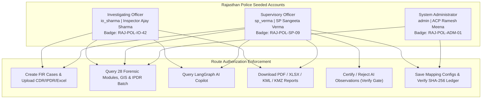

# Security, RBAC & Cryptographic Audit Chain

## Module Overview

The **Security & Audit Chain Engine** (`app/auth.py`, `app/audit.py`, `app/db.py`) enforces JWT-based **Role-Based Access Control (RBAC)** alongside a **tamper-evident SHA-256 hash-chained `AuditLog` ledger** engineered for **Section 65B(4) Indian Evidence Act, 1872 / Section 63 BSA 2023** digital evidence certification.

---

## Multi-Tier RBAC Architecture (`app/auth.py`)



### Seeded Police Officer Credentials (`app/auth.py`)

Passwords are stored hashed with `bcrypt` and authenticated into signed JWT Bearer tokens (`POST /api/auth/login`):

| Username | Full Name | Role Key | Badge Number | Default Password | Operational Mandate |
| :--- | :--- | :--- | :--- | :--- | :--- |
| **`io_sharma`** | Inspector Ajay Sharma | `investigating_officer` | `RAJ-POL-IO-42` | `IO@RajPolice2026` | Leads investigations; registers FIRs, uploads evidence, runs analytics, queries AI Copilot, exports reports |
| **`sp_verma`** | SP Sangeeta Verma | `senior_officer` | `RAJ-POL-SP-09` | `SP@RajPolice2026` | Supervisory oversight; exclusive ability to `verify` or `reject` AI observations prior to judicial use |
| **`admin`** | ACP Ramesh Meena | `admin` | `RAJ-POL-ADM-01` | `Admin@RajPolice2026` | System administration; inspects logs, verifies SHA-256 hash chain integrity, configures operator mappings |

---

## Cryptographic SHA-256 Hash-Chained Audit Ledger (`app/audit.py`)

Unlike mutable plain-text logs, every action logged via `log_audit_event(...)` is cryptographically linked to the immediately preceding row, forming a verifiable blockchain-style ledger inside SQLite (`audit_logs`):

```python
def compute_audit_hash(
    prev_hash: str,
    username: str,
    action: str,
    timestamp_str: str,
    details_str: str,
    ip_addr: str
) -> str:
    raw = f"{prev_hash}|{username}|{action}|{timestamp_str}|{details_str}|{ip_addr}".encode("utf-8")
    return hashlib.sha256(raw).hexdigest()
```

1. **Genesis Anchor:** If no prior hashed record exists, `prev_hash` initializes to 64 zeros (`"0" * 64`).
2. **Proxy-Aware Client Attribution:** Resolves `X-Forwarded-For` headers (falling back to `request.client.host` or `127.0.0.1`) alongside microsecond UTC timestamps (`datetime.utcnow().isoformat()`).
3. **Logged Action Taxonomy:**
   - `LOGIN` / `LOGIN_FAILED`
   - `CASE_CREATED` / `CASE_STATUS_UPDATED`
   - `UPLOAD` (CDR/IPDR ingestion summary with valid & rejected row counts)
   - `QUERY` (patterns, common contacts, IPDR match & batch, tower timeline, meetings, threat/heatmap/network lookups)
   - `AI_QUERY` / `OBSERVATION_VERIFY`
   - `EVIDENCE_VIEW` / `REPORT_DOWNLOAD`

---

## Ledger Integrity Verification (`verify_audit_integrity` & `/api/audit/verify`)

Any unauthorized direct database modification (`UPDATE`, `DELETE`, or timestamp/detail tampering on any historical row) breaks either `entry_hash` recomputation or the `prev_hash` linkage of subsequent rows.

Calling `GET /api/audit/verify` (accessible to all authenticated roles) walks all `AuditLog` rows sequentially from ID `1..N` and returns:
- `is_valid`: `true` or `false`
- `verification_status`: `"AUTHENTIC"` or `"INTEGRITY_BREACH_DETECTED"`
- `total_records` & `verified_records`
- `tampered_records`: Exact offending record IDs, timestamps, actions, and mismatch reasons
- `genesis_hash` & `latest_hash`: Embedded directly into Section 8 PDF certificates and Sheet 6 of Excel exports.
