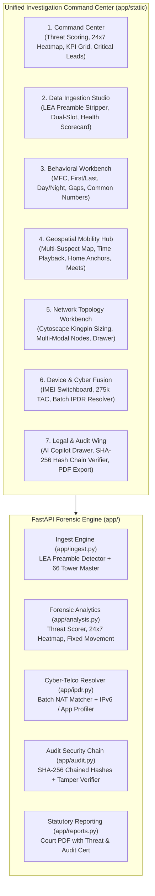

# Design Spec: Syndicate Intelligence Command Center Consolidation

**Date:** 2026-11-25  
**Status:** In Review (Brainstorming Phase Approval)  
**Scope:** Backend (`app/db.py`, `app/ingest.py`, `app/analysis.py`, `app/ipdr.py`, `app/audit.py`, `app/reports.py`, `app/main.py`), Frontend (`app/static/index.html`, `app/static/app.js`, `app/static/style.css`), Datasets & Configs (`data/`), Tests (`tests/`)

---

## 1. Intent & Why

The Rajasthan Police Hackathon CDR/IPDR Analysis Tool & AI Copilot (PS03) has an extensive backend with 2,000+ lines of forensic algorithms and 35+ API endpoints. However, the current interface has grown into a flat 36-button sidebar with fragmented single-table views, while several valuable datasets (`rajasthan_cell_towers_master.csv`, `tac_full.csv`, `mcc_mnc_india.csv`, real LEA sample files) remain underutilized.

Police officers, investigators, and supervisory SPs evaluating the prototype need:
1. **High Visual Density & Executive Clarity:** An Investigation Command Center that highlights suspect threat profiles, 24x7 activity heatmaps, and critical anomalies in seconds rather than clicking through 36 separate tables.
2. **True LEA Telecom Ingestion:** Support for raw Law Enforcement Agency (LEA) formats (Bharti Airtel and Reliance Jio) that contain metadata header preambles, and enriched tower master data covering Mewat/Bharatpur border zones.
3. **Cyber-Telco Fusion:** Bridging traditional CDR voice/SMS calls with Carrier-Grade NAT (CGNAT) IPDR sessions (WhatsApp/Telegram VoIP, YONO/IMPS banking gateways) on a unified spatiotemporal canvas.
4. **Intuitive Workbenches:** Consolidating 36 flat sidebar items into 7 cohesive, deep-dive Investigation Workbenches with sub-tabs, slide-in node drawers, and animated map playback.
5. **Tamper-Evident Judicial Assurance:** Section 65B audit trails with actual SHA-256 hash chaining and an interactive "Verify Chain Integrity" tool.

---

## 2. Goals, Non-Goals & Anti-Goals

### Goals
1. **Consolidated 7-Workbench Architecture:**
   - 🎛️ **Command Center:** Executive dossier, computed Suspect Threat Risk Scores (0-100) & Archetype Badges (`Kingpin`, `Night Phisher`, `Mule Cashout`, `SIM Swapper`, `Associate`), 24x7 Hour×Day Activity Heatmap, Critical Anomaly Strip, and Call-Burst detector.
   - 📂 **Data Ingestion Studio:** Dual-format CSV/Excel upload with automatic LEA preamble stripping (Bharti Airtel & Jio), data health scorecards, and tower enrichment.
   - 👥 **Behavioral Analytics:** Deep sub-tabbed workbench (MFC, First/Last, Day/Night, Silence Gaps, Service/International, Common Numbers).
   - 🌐 **Geospatial Hub:** Leaflet map with multi-suspect comparison, animated time-slider playback, Day-Work vs Night-Sleep home anchors, rendezvous pulse rings, and impossible-travel speed alerts (>150 km/h).
   - 🕸️ **Network & Link Workbench:** Cytoscape graph with kingpin centrality node sizing, multi-modal entity toggles (Phone + Shared IMEI + Tower + Public IP), shortest-path linker, and slide-in evidence drawer (replacing `alert()`).
   - 📱 **Device & Cyber Fusion:** Visual IMEI↔MSISDN↔IMSI switchboard chronology, 275k TAC + 200 MCC/MNC integration, Batch IPDR Resolver for 1930/bank cyber fraud IP lists, and CDR+IPDR unified stream.
   - ⚖️ **Legal, Copilot & Audit Wing:** Context-aware AI Copilot with quick-lead buttons, Section 65B tamper-evident SHA-256 hash chain with interactive verification, and court-admissible PDF/Excel exports.
2. **100% Backward Compatibility:** All existing 35+ API routes and 41/41 unit/integration tests must continue to pass without regression.
3. **Real LEA Format Compatibility:** Clean ingestion for `airtel_lea_cdr.csv` and `jio_lea_cdr.csv` without requiring manual pre-cleaning.
4. **Enriched Master Data:** Ingest all 66 Rajasthan towers (including Mewat/Bharatpur border cell sites) and support full TAC lookups.

### Non-Goals
- Replacing SQLite WAL storage with external databases (PostgreSQL/MySQL), as SQLite is ideal for portable forensic demonstration.
- Implementing real audio wiretapping (strictly prohibited by Section 5(2) Indian Telegraph Act guardrail).

### Anti-Goals
- Removing or breaking any existing analysis view or API endpoint.
- Re-introducing hardcoded demo data or pre-loaded cases (retaining clean ingestion-first gate).

---

## 3. Approaches Considered & Trade-offs

- **Approach A (Selected): Clean 7-Workbench Consolidation + Backend Intelligence & LEA/Mewat Fusion**
  - Group existing views into 7 logical workbenches with sub-tab navigation; build new visual widgets (24x7 heatmap, risk scorer, map playback, slide-in node drawer, batch IPDR, SHA-256 audit chain).
  - *Pros:* 10x superior UX, clean visual command center, zero cluttered sidebar, retains 100% test compatibility.
  - *Trade-off:* Requires coordinated updates across HTML, CSS, JS, and backend helper routes.
- **Approach B (Rejected): Keep 36 Flat Sidebar Tabs As-Is**
  - Add features into individual tabs without consolidating the sidebar.
  - *Rejected:* Keeps sidebar overwhelming with 36 buttons and fragmented navigation.

---

## 4. Architectural & Component Design

### A. Backend Intelligence Enhancements

1. **LEA Preamble & Ingestion Engine (`app/ingest.py`)**:
   - `read_tabular_bytes`: Detects when leading rows contain telecom agency metadata (e.g. `BHARTI AIRTEL LIMITED`, `Ticket Number : LEA...`), auto-skips to the real header row containing `Target No`, `Calling Party`, `Date`, etc.
   - `seed_towers_from_csv`: Checks `data/rajasthan_cell_towers_master.csv` (66 towers) first; upserts towers so all Mewat/Bharatpur border sites (`RAJ-DEG-603`, `RAJ-KMN-604`, `RAJ-GPL-607`, etc.) are recognized.
   - Optional IMEI tolerance: when CDR has valid call/SMS metadata but blank IMEI, flag as `WARNING_MISSING_IMEI` rather than discarding the entire transaction.

2. **Forensic Analytics & Risk Scoring (`app/analysis.py`)**:
   - `calculate_suspect_threat_scores(case_id, db)`: Computes an objective Threat Score (0–100) based on:
     - Nocturnal activity ratio (>25% night calls = +25 pts)
     - SIM/IMEI swap activity (Multi-SIM = +30 pts)
     - High-velocity/impossible travel (>150 km/h = +20 pts)
     - International/High-Risk contact links (+15 pts)
     - Common syndicate links to other suspects (+10 pts)
     - Assigns Archetype: `Kingpin / Syndicate Head`, `Night Phisher`, `Mule Cashout`, `Burner Swapper`, `Active Operative`.
   - `get_temporal_heatmap_24x7(case_id, db, target_number)`: Generates a 24-hour × 7-day matrix of call counts for interactive intensity visualization.
   - Fix movement hops: Ensure transitions are calculated per-subscriber rather than cross-subscriber to prevent phantom high-speed hops.
   - TAC integration: In-memory dictionary cache of `tac_full.csv` (275k records) with instant lookup, enriched by `mcc_mnc_india.csv` (200 records) for Indian circle attribution.

3. **Batch IPDR & Cyber-Telco Fusion (`app/ipdr.py`)**:
   - `batch_match_ipdr_sessions(case_id, query_list, db)`: Accepts multiple IP:Port:Timestamp tuples (such as those from 1930 Cyber Fraud logs or Bank ATM access logs) and resolves subscriber attribution in one query.
   - App signature profiling: Breakdown of data sessions by category (Banking/UPI, Encrypted VoIP, Social Media, Cloud/VPN).

4. **Tamper-Evident SHA-256 Audit Chain (`app/audit.py` & `app/db.py`)**:
   - `AuditLog` table: Add `prev_hash` and `entry_hash` columns (with backward-compatible migration).
   - Each audit entry calculates: `entry_hash = SHA256(prev_hash + username + action + timestamp + details)`.
   - `verify_audit_integrity(db)`: Recalculates the entire hash chain from Genesis entry; returns status (`VERIFIED` or `TAMPERED`), total entries checked, and break location if altered.

5. **API Endpoints (`app/main.py`)**:
   - `GET /api/cases/{case_id}/threat-scoring`: Returns scored suspect dossiers.
   - `GET /api/cases/{case_id}/heatmap`: Returns 24×7 hour/day matrix.
   - `POST /api/cases/{case_id}/ipdr/batch`: Executes batch IPDR resolution.
   - `GET /api/audit/verify`: Verifies SHA-256 chain integrity.
   - Existing endpoints remain unchanged for full backward compatibility.

### B. Frontend Workbench Consolidation

1. **Navigation Structure (`app/static/index.html`)**:
   - Sidebar restructured into 7 primary Workbench buttons with active indicators and badges.
   - Sub-tab headers inside each workbench let users switch between detailed views without leaving context.
   - Legacy view IDs (`view-dashboard`, `view-mfc`, `view-graph`, `view-raw-cdr`, etc.) remain in place inside their respective workbenches so existing deep-linking and JS dispatches continue to work smoothly.

2. **Visual Enhancements (`app/static/app.js` & `app/static/style.css`)**:
   - **Executive Dashboard:**
     - Suspect Threat Cards with color-coded risk meter (Red = Critical, Amber = High, Blue = Moderate).
     - Interactive 24x7 Heatmap using Chart.js / CSS Grid.
     - Anomaly Alert Strip with one-click filter actions.
   - **Geospatial Hub:**
     - Multi-suspect trajectory overlays (Color-coded: Suspect 1 Gold, Suspect 2 Teal).
     - Time-slider playback controller (Play/Pause/Scrub).
     - Co-location rendezvous markers with pulsing rings.
   - **Network Topology:**
     - Cytoscape node sizes dynamically mapped to Betweenness/Degree Centrality.
     - Slide-in Evidence Drawer upon node tap (showing linked suspects, total calls, tower anchors, and Section 65B rows) replacing browser `alert()`.
   - **Device & Cyber Fusion:**
     - Visual IMEI↔SIM Switchboard Chronology.
     - Batch IPDR Resolver modal & CSV paste input.
   - **Legal & Audit:**
     - Interactive "Verify SHA-256 Chain" button with live integrity badge.

---

## 5. Verification & Testing Plan

1. **Existing Test Suite:**
   - Run `PYTHONPATH=. pytest tests/ -v` to confirm all 41 existing tests pass with 0 regressions.
2. **New Automated Tests:**
   - Test LEA preamble parsing (`airtel_lea_cdr.csv`, `jio_lea_cdr.csv`).
   - Test `calculate_suspect_threat_scores` output format and scoring ranges.
   - Test `get_temporal_heatmap_24x7` 24×7 matrix output.
   - Test `batch_match_ipdr_sessions` multi-tuple resolution.
   - Test SHA-256 audit hash chain calculation and verification.
3. **E2E & UI Verification:**
   - Ingest `case-2026-mewat` and LEA samples.
   - Verify workbench switching, 24x7 heatmap rendering, network slide-in drawer, Leaflet playback, and audit chain verification.

---

## 6. What's Left to the Builder
- Implementing the backend functions in `app/analysis.py`, `app/ingest.py`, `app/ipdr.py`, `app/audit.py`, `app/main.py`.
- Updating HTML/CSS/JS in `app/static/` to render the 7 workbenches and visual widgets.
- Writing unit tests in `tests/test_forensic_suite.py` for new capabilities.
- Verifying the complete test suite.
